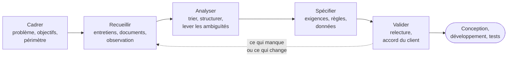
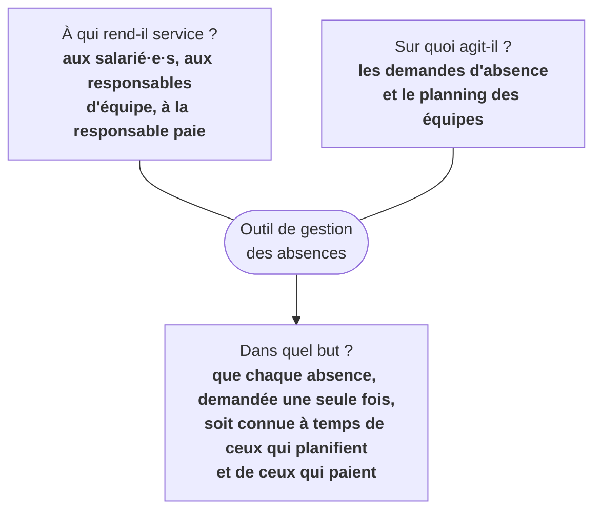
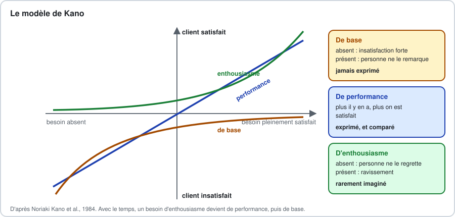
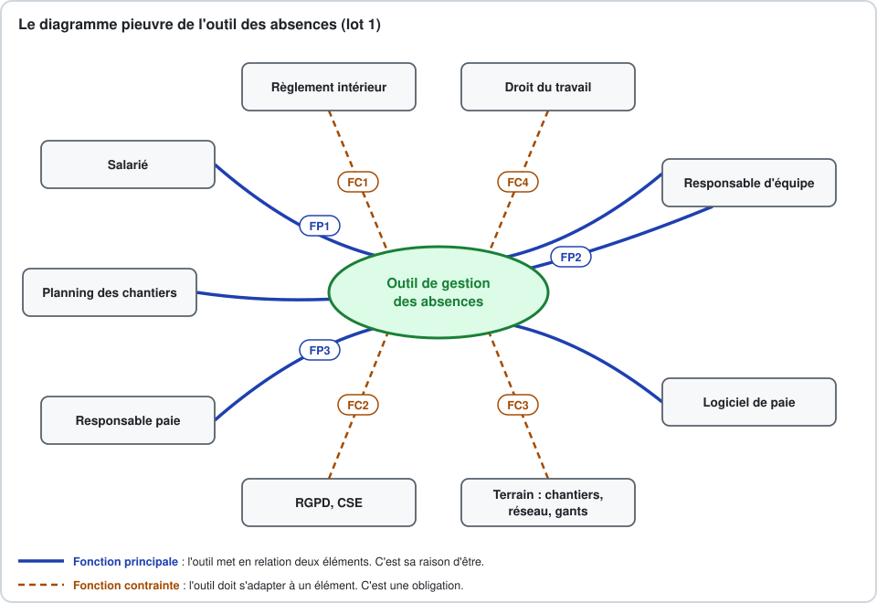

[Sommaire](Readme.md) · [Chapitre suivant →](02-J1-Atelier-Cadrer-le-besoin.md)

# Jour 1 · Cours - Analyser le besoin

> **Jour 1, matin - 2 h 15, ouverture comprise.** Ce matin, vous voyez la démarche sur le lot 1 du projet Brunel, et vous l'exercez sur le lot 2 ; cet après-midi, vous cadrerez entièrement le lot 2 dans l'[atelier "Cadrer le besoin"](02-J1-Atelier-Cadrer-le-besoin.md).

## 🎯 Objectifs

À la fin de cette matinée, vous saurez :

1. Distinguer une demande, un besoin, une exigence et une solution, et remonter d'une demande au problème qu'elle doit résoudre.
2. Situer l'analyse du besoin dans un projet : qui la mène, qui y contribue, à quel moment.
3. Cadrer un projet : énoncé du problème, objectifs SMART, périmètre, contraintes, hypothèses, risques.
4. Choisir les techniques de recueil adaptées, et tirer d'un document existant des données, des règles et des questions.
5. Repérer les besoins que personne n'exprime, avec le modèle de Kano et le diagramme pieuvre.
6. Construire un glossaire métier et lever les ambiguïtés du vocabulaire.

## Déroulé de la matinée

| Horaire | Séquence | Durée |
|---|---|---|
| 09:00 | Ouverture : tour de table, présentation du module, du fil rouge et des exemples | 15 min |
| 09:15 | 1. Demande, besoin, exigence, solution · 2. Qui analyse le besoin, et quand | 25 min |
| 09:40 | 3. Cadrer le projet, avec l'exercice 1 | 30 min |
| 10:10 | Pause | 15 min |
| 10:25 | 4. Recueillir le besoin, avec l'exercice 2 | 30 min |
| 10:55 | 5. Les besoins qu'on ne dit pas | 15 min |
| 11:10 | 6. Parler la même langue : le glossaire, avec l'exercice 3 · 7. Ce qu'on garde pour demain | 20 min |
| 11:30 | *Marge : questions, exercice bonus, ou lecture du dossier du lot 2* | *jusqu'à 12:30* |

## Ce que vous savez déjà, et ce que ce cours ajoute

Vous n'arrivez pas les mains vides. Les deux modules précédents vous ont donné des outils que ce cours **suppose acquis** et qu'il va mettre au service d'un autre objectif.

| Vous avez déjà vu | Dans le module | Ce que ce cours en fait |
|---|---|---|
| entretien semi-directif, biais, personas, parcours | UX et maquettage, jour 1 | on interroge aussi le **commanditaire** et les **experts métier**, pas seulement les utilisateurs |
| user stories, INVEST, critères d'acceptation Gherkin, MoSCoW | UX et maquettage, jour 2 | on les relie à des **exigences** identifiées, tracées et validées |
| exigences fonctionnelles et non fonctionnelles, en deux lignes | UX et maquettage, jour 2 | on les classe, on les rédige avec des gabarits, on les rend **vérifiables** |
| écosystème, promesse, blueprint, systèmes existants | Design de service, jour 1 | on y puise les acteurs, les contraintes et les **règles de gestion** |
| diagramme de cas d'utilisation, domaine, niveaux de service | Design de service, jour 2 | on écrit les cas d'utilisation **en texte**, on détaille les données, on trace jusqu'au test |

Ce qui est nouveau tient en une phrase : **passer de "comprendre" à "s'engager"**. Une spécification est ce sur quoi le client et l'équipe se mettent d'accord. Elle doit donc être juste, complète, sans ambiguïté, et vérifiable par les deux parties.

## Le projet du module

Un seul projet pendant deux jours, et un seul commanditaire : l'**Atelier Brunel**. Les exemples du cours portent sur son **lot 1, les absences**. Les exercices, puis les ateliers, portent sur son **lot 2, le planning des chantiers de pose**, décrit dans l'[annexe A](A-Projet-Brunel.md). On vous montre la démarche sur le lot 1 ; vous l'exercez sur un morceau du lot 2 ; la correction, faite ensemble, devient le point de départ de l'atelier.

**Le lot 1, l'exemple du cours.** L'Atelier Brunel est une entreprise de menuiserie et d'agencement de soixante-deux salarié·e·s : trente-huit à l'atelier de fabrication, répartis en trois équipes ; seize poseur·se·s qui travaillent en binômes sur les chantiers ; huit personnes au bureau, dont Sandrine, seule à la paie et aux ressources humaines. Aujourd'hui, une absence se demande sur un formulaire papier, signé par le chef d'atelier ou le conducteur de travaux, déposé au bureau, recopié par Sandrine dans un tableur, puis ressaisi dans le logiciel de paie. Le planning des chantiers tient sur un tableau blanc. Paul Brunel, le dirigeant, a envoyé ce message :

> "Il nous faudrait une appli mobile pour les congés, comme chez les grands groupes, avec des notifications. Les gars en ont marre du papier. Vous pouvez nous faire ça pour la rentrée ?"

**Le lot 2, le sujet des exercices et des ateliers.** Le cadrage du lot 1, que vous verrez ce matin, laisse hors de son périmètre "la planification complète des chantiers". Paul Brunel vous la confie ensuite : le planning des seize poseur·se·s, tenu aujourd'hui par les deux conducteurs de travaux sur un tableau blanc. Lisez l'[annexe A](A-Projet-Brunel.md) avant l'exercice 1 : le contexte et les observations suffisent pour ce matin.

---

## 1. Demande, besoin, exigence, solution

### 1.1 Quatre mots qu'on ne confond plus

| Mot | Ce que c'est | Qui l'exprime | Chez Brunel |
|---|---|---|---|
| **Demande** | ce que le client dit vouloir, avec ses mots | le commanditaire | "une appli mobile pour les congés, avec des notifications" |
| **Besoin** | le problème à résoudre, ou le résultat à obtenir, indépendamment de toute solution | on le **reconstitue**, à partir de la demande et des faits | savoir à l'avance qui sera absent pour planifier les chantiers ; ne plus ressaisir trois fois la même absence ; permettre à chacun de connaître son solde sans appeler le bureau |
| **Exigence** | ce que la solution **doit** faire ou respecter, formulé de manière vérifiable | l'équipe, **validée** par le client | "Quand un responsable valide une demande d'absence, le système doit l'inscrire dans le planning de l'équipe concernée." |
| **Solution** | la manière de satisfaire les exigences | l'équipe de conception | une application web responsive, un export vers le logiciel de paie |

La demande de Paul Brunel contient **une solution** - une application mobile -, **un moyen** - des notifications - et **une échéance** - la rentrée. Elle ne contient aucun besoin explicite. C'est normal : un client parle de ce qu'il imagine, pas de ce qu'il cherche à obtenir. Votre travail commence là.

> **Le besoin est ce qui reste quand on retire la solution de la demande.**

### 1.2 Remonter de la solution au problème

La technique la plus simple est celle des **cinq pourquoi**, née chez Toyota pour remonter à la cause d'un défaut. On demande "pourquoi ?" jusqu'à atteindre quelque chose qui ne dépend plus d'une solution. Cinq est un ordre de grandeur, pas une règle.

| | Question | Réponse de Paul Brunel |
|---|---|---|
| 1 | Pourquoi une application pour les congés ? | "Parce que le papier, ça se perd." |
| 2 | Pourquoi est-ce un problème qu'un formulaire se perde ? | "Parce qu'après, personne ne sait que le gars est en congé." |
| 3 | Pourquoi faut-il le savoir ? | "Parce que le conducteur de travaux doit prévoir ses équipes de pose." |
| 4 | Que se passe-t-il quand il ne le sait pas ? | "Le chantier démarre à un seul poseur. C'est arrivé quatre fois l'an dernier, dont une fois chez notre plus gros client." |
| 5 | Qu'est-ce que cela vous coûte ? | "Des pénalités de retard, et un client qui hésite à revenir." |

Le besoin n'était pas "dématérialiser les congés" : c'était **garantir que les équipes de pose prévues sont complètes**. La différence est considérable. Elle dit que l'utilisateur le plus important n'est peut-être pas le salarié qui pose ses congés, mais le conducteur de travaux qui planifie. Elle dit aussi qu'une application qui gérerait parfaitement les congés sans alimenter le planning des chantiers serait un échec.

Deux précautions :

- **Le ton.** Cinq "pourquoi ?" d'affilée ressemblent à un interrogatoire. Variez : "Qu'est-ce qui se passe quand… ?", "Qu'est-ce que cela vous permettrait ?", "Racontez-moi la dernière fois que…".
- **Plusieurs chemins.** Une demande cache souvent plusieurs besoins. Le même exercice, mené avec Sandrine, aboutit ailleurs : "Je passe trois heures par semaine à ressaisir et à répondre au téléphone, et j'ai fait deux erreurs de paie cette année."

### 1.3 Pourquoi c'est votre affaire

Le dessin de la balançoire circule dans les équipes informatiques depuis les années 1970 : ce que le client a demandé, ce que le chef de projet a compris, ce que l'analyste a conçu, ce que le développeur a codé… et ce dont le client avait vraiment besoin, un pneu accroché à une branche. Il fait rire parce qu'il est juste.

- **Les erreurs de compréhension sont les plus coûteuses.** Barry Boehm a montré, dès 1981, que le coût de correction d'un défaut croît fortement avec la phase où on le découvre. Les ratios exacts sont discutés depuis, la tendance ne l'est pas : une phrase se corrige en une minute, une fonctionnalité livrée en plusieurs jours.
- **Les projets échouent d'abord sur le besoin.** Dès son premier rapport, en 1994, le Standish Group classait le manque d'implication des utilisateurs, les exigences incomplètes et les exigences instables parmi les premières causes de dérive des projets.
- **Le développeur qui code la demande n'est pas protégé.** S'il livre exactement ce qui a été demandé et que cela ne sert à rien, le projet a échoué, et il en paie le prix en maintenance.
- **Le jury vous demandera pourquoi.** Pourquoi cette fonctionnalité, pourquoi pas celle-là, pourquoi cette règle. La réponse est dans votre analyse du besoin, ou elle n'est nulle part.

---

## 2. Qui analyse le besoin, et quand

### 2.1 Les rôles

| Rôle | Qui c'est | Ce qu'il apporte | Chez Brunel |
|---|---|---|---|
| **Commanditaire** | celui qui décide, finance et valide | les objectifs, le budget, l'arbitrage | Paul Brunel |
| **Maîtrise d'ouvrage** (MOA) | l'organisation qui exprime le besoin et recevra la solution | le besoin, les règles métier, la recette | l'Atelier Brunel |
| **Experts métier** | ceux qui connaissent les règles et les exceptions | les règles de gestion, les cas particuliers | Sandrine ; le conducteur de travaux |
| **Utilisateurs finaux** | ceux qui se serviront de la solution | l'usage réel, les contraintes du terrain | les salarié·e·s, les responsables d'équipe |
| **Maîtrise d'œuvre** (MOE) | l'équipe qui conçoit et réalise | la faisabilité, les coûts, les alternatives | votre équipe |
| **Assistance à maîtrise d'ouvrage** (AMOA), *business analyst* | celui qui aide la MOA à formuler son besoin | la méthode, la formalisation | parfois vous |
| ***Product owner*** | dans une équipe Scrum, celui qui porte la vision du produit et ordonne le backlog | les priorités, l'acceptation des stories | - |

Le couple MOA / MOE est une tradition française, héritée des marchés publics de travaux. Dans une équipe agile, la frontière est plus floue : le *product owner* joue l'essentiel du rôle de la MOA au sein de l'équipe. Mais la question demeure : **qui a le droit de dire ce qui est demandé, et qui a le droit de dire que c'est fait ?**

> En début de carrière, vous serez souvent seul·e face au client, dans une petite structure, et vous jouerez tous les rôles de la colonne MOE. Raison de plus pour savoir les distinguer.

### 2.2 Une activité, pas une phase

L'analyse du besoin suit un cycle, qui se répète à chaque nouvelle information :



- **Dans un cycle en V**, ce cycle se déroule pour l'essentiel avant la conception, et aboutit à un cahier des charges validé une fois pour toutes. Le risque : figer trop tôt ce qu'on ne connaît pas encore.
- **Dans une démarche agile**, il se répète à chaque itération : on cadre une fois, on spécifie en détail ce qui sera développé bientôt, et on reste vague sur le lointain. Le risque inverse : ne jamais rien écrire, et découvrir au sprint 6 une règle qui remet en cause le sprint 2.

Dans les deux cas, le **cadrage** se fait au début, et il se fait bien. C'est l'objet de la partie suivante.

---

## 3. Cadrer le projet

Le cadrage répond à six questions avant d'en poser mille : quel est le problème, pour qui, qu'est-ce qu'un succès, qu'est-ce qui est dans le projet et qu'est-ce qui n'y est pas, à quoi doit-on se plier, et qu'est-ce qui pourrait mal tourner. Il tient en quelques pages : la **note de cadrage** ([B.7](B-Modeles-et-canevas.md)).

### 3.1 L'énoncé du problème

Un gabarit en quatre temps, repris de la méthode RUP (*Rational Unified Process*), oblige à parler du problème avant la solution :

> **Le problème de** [description du problème]
> **affecte** [qui],
> **ce qui a pour conséquence** [impact mesurable].
> **Une solution réussie permettrait de** [bénéfices attendus].

Chez Brunel :

> **Le problème de** la circulation des demandes d'absence, sur papier et par ressaisies successives,
> **affecte** les conducteurs de travaux, la responsable paie et l'ensemble des salarié·e·s,
> **ce qui a pour conséquence** des chantiers démarrés avec une équipe incomplète - quatre l'an dernier -, trois heures de ressaisie par semaine et deux erreurs de paie en douze mois.
> **Une solution réussie permettrait de** connaître les absences dès leur validation, de ne les saisir qu'une fois, et de donner à chacun son solde à tout moment.

### 3.2 Faire le tour de la question : QQOQCCP

Le questionnement **QQOQCCP** - qui, quoi, où, quand, comment, combien, pourquoi - est une liste de contrôle, pas un formulaire à remplir. Il sert à repérer ce qu'on ne sait pas encore.

| Question | Chez Brunel | Ce qu'on ne sait pas encore |
|---|---|---|
| **Qui ?** | 62 salarié·e·s ; 3 chefs d'atelier, 2 conducteurs de travaux ; Sandrine ; Paul Brunel | les intérimaires, en renfort l'été, sont-ils concernés ? |
| **Quoi ?** | des demandes d'absence : congés, mais aussi maladie, événements familiaux, sans solde | les heures supplémentaires récupérées en font-elles partie ? |
| **Où ?** | à l'atelier, sur les chantiers, à la maison | tous les poseurs ont-ils un smartphone professionnel ? Y a-t-il du réseau sur les chantiers ? |
| **Quand ?** | toute l'année, avec un pic en mars-avril pour l'été | la fermeture d'août est-elle toujours de trois semaines ? |
| **Comment ?** | formulaire papier, signature, tableur, logiciel de paie | le logiciel de paie sait-il importer des absences ? Sous quel format ? |
| **Combien ?** | environ 400 demandes par an ; un budget "raisonnable", selon le dirigeant | quel budget, réellement ? Qui maintiendra l'outil ? |
| **Pourquoi ?** | équipes incomplètes, ressaisies, erreurs de paie | - |

La dernière colonne est la plus précieuse : elle devient la liste des questions de l'entretien de cadrage.

### 3.3 À quoi sert le produit : la bête à cornes

La **bête à cornes** vient de la méthode APTE d'analyse fonctionnelle, née en France dans les années 1960 et toujours enseignée en ingénierie. Elle formule la raison d'être du produit en trois questions :



Si l'équipe ne parvient pas à remplir la case "dans quel but ?" sans y mettre une solution, le besoin n'est pas encore compris.

### 3.4 Des objectifs SMART

Un objectif dit ce que le projet doit **changer**, et comment on saura qu'il l'a fait. Le critère **SMART** a été proposé par George T. Doran en 1981 ; la version la plus répandue aujourd'hui en donne cette lecture :

| Lettre | Critère | La question à poser |
|---|---|---|
| **S** | Spécifique | De quoi parle-t-on exactement, et pour qui ? |
| **M** | Mesurable | Avec quel indicateur, et quelle valeur de départ ? |
| **A** | Atteignable - à l'origine, chez Doran, *assignable* : attribué à quelqu'un | Est-ce à la portée du projet ? Qui en répond ? |
| **R** | Réaliste | Avec ces moyens, ce budget, ces gens ? |
| **T** | Temporellement défini | Pour quand ? |

| Objectif mal formulé | Objectif SMART |
|---|---|
| "Moderniser la gestion des congés." | "D'ici au 31 mars, plus aucune demande d'absence n'est saisie plus d'une fois : le temps consacré aux absences par la responsable paie passe de 3 h à moins de 45 min par semaine." |
| "Améliorer la planification." | "Sur la saison de pose d'avril à octobre, aucun chantier ne démarre avec une équipe incomplète du fait d'une absence validée - contre quatre l'an dernier." |
| "Zéro erreur." | "Aucune erreur de paie liée à une absence sur les six premiers mois d'utilisation, contre deux sur les douze derniers mois." |

Trois remarques :

- **Un objectif n'est pas une exigence.** "Moins de 45 min par semaine" ne se teste pas dans le logiciel : il se constate après la mise en service. Les exigences, demain, diront ce que le logiciel doit faire pour qu'on l'atteigne.
- **Sans valeur de départ, pas d'objectif.** "Réduire les erreurs de paie" ne veut rien dire si personne ne sait combien il y en a aujourd'hui. Le cadrage sert aussi à mesurer l'existant.
- **Trois à cinq objectifs suffisent.** Au-delà, ce sont des fonctionnalités déguisées.

### 3.5 Le périmètre, les contraintes, les hypothèses, les risques

**Le périmètre** se décrit en trois colonnes. La colonne du milieu est la plus importante : ce qui n'est pas écrit comme exclu sera un jour réclamé comme inclus.

| Dans le périmètre | Hors périmètre | Plus tard, peut-être |
|---|---|---|
| demander, valider, refuser, annuler une absence | le calcul de la paie elle-même | les heures supplémentaires récupérées |
| consulter son solde | la gestion des notes de frais | l'application mobile native |
| le planning des absences par équipe | la planification complète des chantiers | les intérimaires |
| l'export des absences vers le logiciel de paie | les entretiens annuels | - |

**Les contraintes** ne se discutent pas : elles s'imposent au projet.

| Type | Chez Brunel |
|---|---|
| Réglementaire | droit du travail sur les congés payés ; RGPD : les absences pour maladie sont des données de santé, dont l'accès doit être strictement limité |
| Organisationnelle | le règlement intérieur de l'entreprise, ses délais, sa fermeture d'août ; le comité social et économique (CSE) à informer avant la mise en service d'un outil qui traite des données des salarié·e·s |
| Technique | le logiciel de paie existant, qui importe un fichier CSV ; pas de service informatique interne |
| Calendrier et budget | mise en service souhaitée en septembre ; budget à préciser |

**Les hypothèses** sont ce qu'on tient pour vrai sans l'avoir vérifié. On les écrit pour pouvoir les vérifier, et pour savoir quoi revoir si elles tombent : "Tous les salariés disposent d'un smartphone ou d'un accès à un poste à l'atelier." "Le logiciel de paie accepte l'import de fichiers d'absences."

**Les risques** sont des événements incertains qui menaceraient les objectifs. Pour chacun, sa probabilité, son impact, et ce qu'on fait pour le réduire.

| Risque | Probabilité | Impact | Réponse |
|---|---|---|---|
| Les poseurs n'utilisent pas l'outil et continuent à demander oralement | moyenne | fort : le planning reste faux | les associer dès la conception ; permettre au conducteur de travaux de saisir une demande pour quelqu'un |
| L'import dans le logiciel de paie ne fonctionne pas comme prévu | moyenne | fort : la ressaisie demeure | vérifier le format avec l'éditeur **avant** de spécifier l'export |
| Le dirigeant attend une application native, dans les stores | forte | moyen : déception | en parler au cadrage, avec les coûts comparés |

### Exercice 1 - Cadrer le lot 2 (10 min)

En binôme. Voici le message que Paul Brunel vient d'envoyer pour la suite du projet, et trois faits relevés au bureau. Ils figurent aussi dans l'[annexe A](A-Projet-Brunel.md).

> "Maintenant que les absences sont lancées, on voudrait faire pareil pour le planning des chantiers. Un grand tableau sur écran, comme notre tableau blanc, mais que tout le monde puisse voir sur son téléphone, avec le GPS des camions pour savoir où sont les équipes. Nadia et Marc passent leur vendredi après-midi à refaire le planning, et ils s'appellent dix fois par jour. Et l'été, quand on prend des intérimaires, c'est la pagaille. Il faudrait que ce soit prêt pour la saison de pose, en avril. - Paul"

- L'an dernier, 37 chantiers ont été replanifiés moins de 48 heures avant leur début : 22 parce que les menuiseries n'étaient pas prêtes, 9 à cause d'une absence, 6 à la demande du client.
- Nadia et Marc, les deux conducteurs de travaux, passent chacun environ 4 heures le vendredi à refaire le planning de la semaine suivante.
- Les clients ont adressé 14 réclamations pour une pose annoncée et non faite, ou décalée sans prévenir.

1. Isolez, dans le message, la **solution** et les **problèmes**.
2. Écrivez l'**énoncé du problème** avec le gabarit de la partie 3.1.
3. Proposez **deux objectifs SMART**.
4. Citez **trois éléments hors périmètre** qu'il faudrait faire confirmer.

<details>
<summary>Voir la correction</summary>

**1. Solution et problèmes.** La solution : "un grand tableau sur écran", "sur son téléphone", "le GPS des camions". Les problèmes : le temps passé à refaire le planning, les appels incessants entre conducteurs, la désorganisation de l'été. Les faits en ajoutent un que Paul ne cite pas, et c'est le plus coûteux : **des chantiers replanifiés au dernier moment**, d'abord parce que les menuiseries ne sont pas prêtes, et des clients qu'on ne prévient pas. Notez que le GPS ne répond à aucun des problèmes cités : il faudra demander à quoi il servirait.

**2. Énoncé du problème.**

> **Le problème de** la planification des chantiers de pose, tenue sur un tableau blanc sans lien avec l'avancement de la fabrication ni avec les absences, et diffusée par photo,
> **affecte** les conducteurs de travaux, les poseur·se·s, l'assistante commerciale et les clients,
> **ce qui a pour conséquence** 37 chantiers replanifiés à moins de 48 heures l'an dernier, dont 22 faute de menuiseries prêtes, 14 réclamations de clients, et 8 heures de replanification chaque semaine.
> **Une solution réussie permettrait de** n'engager que des équipes complètes sur des menuiseries prêtes, et de prévenir chacun - poseurs et clients - de tout changement le jour même.

**3. Deux objectifs SMART**, par exemple :

- "Sur la saison de pose d'avril à octobre prochains, moins de 8 chantiers sont replanifiés à moins de 48 heures faute de menuiseries prêtes, contre 22 l'an dernier."
- "Dès le mois de mai, la préparation du planning hebdomadaire prend moins de 1 h 30 par conducteur de travaux, contre 4 heures."

Un objectif comme "que les clients soient prévenus" est un bon point de départ, mais il faut le rendre mesurable : "Moins de 3 réclamations pour une pose non annoncée sur la saison, contre 14."

**4. Hors périmètre, à faire confirmer**, par exemple : la planification de la **fabrication** en atelier ; la **géolocalisation** des véhicules ; les devis et la facturation ; le calcul des indemnités des poseurs, qui relève de la paie ; la gestion des contrats d'intérim. Chacun de ces sujets touche le planning. Aucun n'a été vraiment demandé, sauf le GPS. Tous le seront, si on ne les exclut pas par écrit - ou si on ne les inclut pas en connaissance de cause.

</details>

---

## 4. Recueillir le besoin

### 4.1 Panorama des techniques

Aucune technique ne suffit seule. Chacune voit ce que les autres ne voient pas.

| Technique | Ce qu'elle apporte | Sa limite | Chez Brunel |
|---|---|---|---|
| **Entretien de cadrage** avec le commanditaire | les objectifs, les priorités, les contraintes, le budget | il parle de ce qu'il imagine, pas de ce qui se passe | Paul Brunel, une heure |
| **Entretien avec un expert métier** | les règles, les exceptions, les cas qui posent problème | il oublie ce qui lui semble évident | Sandrine ; le conducteur de travaux |
| **Observation** sur le terrain | ce que les gens font vraiment, et qu'ils ne savent pas dire | prend du temps ; l'observateur modifie ce qu'il observe | une matinée au bureau, un lundi ; une visite de chantier |
| **Atelier collectif** | les désaccords, les arbitrages, une vision partagée | les voix fortes dominent ; demande une bonne animation | un atelier avec les cinq responsables d'équipe |
| **Analyse documentaire** | les données, les règles écrites, les volumes, l'existant | ce qui est écrit n'est pas toujours ce qui est appliqué | le formulaire papier, le tableur de Sandrine, le règlement intérieur, l'export du logiciel de paie |
| **Questionnaire** | des réponses nombreuses, comparables | ne trouve que ce qu'on a pensé à demander | une question aux 62 salarié·e·s : "Avez-vous un smartphone ? Du réseau sur les chantiers ?" |
| **Prototype ou maquette** | une réaction concrète, là où une description reste abstraite | fait croire que c'est presque fini | une maquette papier du formulaire de demande |

Vous avez pratiqué l'entretien utilisateur et la maquette dans le module d'UX. Ce matin, on s'attarde sur les deux techniques que les développeur·se·s négligent le plus, et qui rapportent le plus pour spécifier : **l'analyse documentaire** et **l'entretien avec le commanditaire et les experts**.

### 4.2 L'analyse documentaire

Un client a toujours des documents. Il ne pense pas à les donner, parce qu'il ne les voit plus. Demandez-les **tous** :

- les **formulaires** papier ou électroniques, remplis si possible : chaque champ est une donnée, chaque case à cocher une liste de valeurs, chaque signature une étape de validation ;
- les **tableurs** : chaque colonne est une donnée, chaque formule une règle de gestion, chaque cellule colorée à la main une règle que personne n'a écrite ;
- les **règlements**, procédures, notes de service, conditions générales : des règles de gestion, déjà rédigées ;
- les **courriers et courriels types** : les notifications que le futur système devra envoyer ;
- les **exports et écrans** des logiciels existants : les formats, les identifiants, les contraintes d'intégration ;
- les **réclamations**, les tickets, les statistiques : les volumes, les pics, et ce qui casse.

Pour chaque document, une même grille d'analyse ([B.3](B-Modeles-et-canevas.md)) : quelles **données**, quelles **règles**, quels **acteurs** et quelles **étapes**, quels **volumes**, et quelles **questions** il soulève.

**Le formulaire papier de Brunel**, analysé :

```text
┌──────────────────────────────────────────────────────────────┐
│ ATELIER BRUNEL - DEMANDE D'ABSENCE                           │
│ Nom : ____________   Équipe : □ Atelier 1 □ Atelier 2        │
│                               □ Atelier 3 □ Pose  □ Bureau   │
│ Type : □ Congés payés  □ Sans solde  □ Événement familial    │
│        □ Autre : ________                                    │
│ Du : __/__/____  □ matin □ après-midi                        │
│ Au : __/__/____  □ matin □ après-midi    Nb de jours : ___   │
│ Date de la demande : __/__/____                              │
│ Signature du salarié :          Visa du responsable :        │
│                                 □ Accordé  □ Refusé          │
│ Cadre réservé RH - Solde avant : ___  Solde après : ___      │
│ Saisi en paie le : __/__/____                                │
└──────────────────────────────────────────────────────────────┘
```

| Ce qu'on y lit | Ce qu'on en tire |
|---|---|
| **Données** | salarié, équipe, type d'absence, date et demi-journée de début et de fin, nombre de jours, date de demande, décision, solde avant et après, date de saisie en paie |
| **Listes de valeurs** | cinq équipes ; quatre types d'absence, plus "autre" |
| **Étapes et acteurs** | le salarié demande, le responsable accorde ou refuse, la RH met à jour le solde puis saisit en paie : trois acteurs, trois étapes |
| **Règles** | on peut poser une demi-journée ; le solde se décompte |
| **Questions** | Qui calcule le "nb de jours", et compte-t-on les samedis ? Que contient "autre" dans la réalité ? La maladie n'y figure pas : comment arrive-t-elle ? Le refus doit-il être motivé ? Que se passe-t-il si le responsable est lui-même absent ? Un salarié peut-il annuler une demande accordée ? |

Les cases "Autre" et "Nb de jours" sont des mines d'or. La première dit que la liste est incomplète ; la seconde, qu'il existe une règle de calcul que personne n'a écrite. Demandez à voir **vingt formulaires remplis** : vous y trouverez, griffonnées dans les marges, les exceptions que personne ne pense à mentionner.

### 4.3 L'entretien de cadrage et l'entretien d'expert

Vous connaissez l'entretien semi-directif. Avec un commanditaire ou un expert métier, l'objectif change : on ne cherche plus à comprendre un vécu, on cherche **des objectifs, des règles et des exceptions**. Quelques questions qui rapportent ([B.2](B-Modeles-et-canevas.md)) :

| Pour obtenir… | Demandez… |
|---|---|
| les objectifs | "Dans un an, qu'est-ce qui vous ferait dire que c'était une réussite ?" "Comment le mesurerez-vous ?" |
| l'existant | "Montrez-moi comment vous faites aujourd'hui." "Racontez-moi la dernière demande qui a posé problème." |
| les règles | "Comment décidez-vous de… ?" "Qui a le droit de… ?" "Qu'est-ce qui est interdit ?" |
| les exceptions | "Et quand ça ne se passe pas comme d'habitude ?" "Quel est le cas le plus tordu que vous ayez vu ?" |
| les volumes | "Combien par jour, par mois, en période de pointe ?" |
| les priorités | "Si on ne pouvait faire qu'une seule chose, ce serait laquelle ?" |
| les limites | "Qu'est-ce qui ne doit surtout pas arriver ?" "Qu'est-ce que l'outil ne doit pas faire ?" |

Trois habitudes à prendre :

- **Reformuler.** "Si je comprends bien, une demande de plus de deux jours doit être faite au moins quinze jours à l'avance, sauf accord de Sandrine. C'est bien ça ?" La reformulation fait apparaître les malentendus pendant l'entretien, quand ils ne coûtent rien.
- **Demander des exemples.** "Un poseur demande trois jours la semaine prochaine : que se passe-t-il ?" Un exemple chiffré vaut dix phrases générales, et il deviendra demain un cas de test.
- **Écrire et faire valider.** Un compte rendu envoyé le jour même, avec les décisions, les règles comprises et les questions ouvertes. Ce qui n'est pas écrit n'a pas été dit.

### 4.4 Les pièges du recueil

| Piège | À quoi on le reconnaît | Que faire |
|---|---|---|
| **La solution déguisée** | la demande contient un outil, une technologie, une référence : "comme chez…" | remonter au problème : partie 1.2 |
| **L'évidence tacite** | l'expert dit "c'est évident" ou ne dit rien | observer, demander des exemples, analyser les documents remplis |
| **Le commanditaire n'est pas l'utilisateur** | celui qui décrit le travail ne le fait pas lui-même | interroger aussi ceux qui le font |
| **Le cas général seulement** | aucune exception dans ce que vous avez recueilli | "Et quand ça ne se passe pas comme d'habitude ?" |
| **Tout est prioritaire** | chaque demande est "indispensable" | faire choisir : "Si vous ne pouviez en garder qu'une…" |
| **Les demandes contradictoires** | le dirigeant veut des notifications partout ; les poseurs ne veulent pas être dérangés le week-end | les écrire côte à côte, et les faire arbitrer par le commanditaire |
| **La règle écrite mais morte** | le règlement dit une chose, le terrain en fait une autre | demander laquelle le logiciel doit appliquer, et le faire écrire |

Le philosophe Michael Polanyi l'a résumé en une phrase en 1966 : "Nous savons plus que nous ne pouvons dire." Un expert ne vous cache rien : il ne sait pas qu'il sait. C'est à vous d'aller le chercher.

### Exercice 2 - Analyser les consignes de pose (10 min)

En binôme. Voici un extrait de la note de service de l'Atelier Brunel sur les consignes de pose. Elle figure en entier dans l'[annexe A](A-Projet-Brunel.md), pièce jointe 2.

> **Article 1 - Équipe de pose.** Chaque chantier est posé par une équipe d'au moins deux poseurs, dont un chef de pose, qui répond du chantier auprès du client.
>
> **Article 4 - Menuiseries.** Un chantier n'est planifié que si le chef d'atelier a déclaré ses menuiseries prêtes, au plus tard la veille à 12 heures.
>
> **Article 5 - Intérimaires.** Un intérimaire ne peut pas être chef de pose. Une équipe compte au plus un intérimaire.
>
> **Article 6 - Information du client.** Le client est informé de la date de pose au moins cinq jours ouvrés à l'avance. Tout changement lui est signalé le jour même.

1. Relevez les **données** que le futur système devra connaître.
2. Relevez les **règles de gestion**, une par ligne.
3. Écrivez au moins **cinq questions** que cette note laisse sans réponse.

<details>
<summary>Voir la correction</summary>

**1. Les données.** Le poseur : s'il est chef de pose ; s'il est salarié ou intérimaire. Le chantier : ses dates de pose, son équipe, son chef de pose, son client. Les menuiseries du chantier : leur état - prêtes ou non -, la date et l'heure de la déclaration, le chef d'atelier qui l'a faite. Le client : de quoi le joindre. L'information du client : sa date, et ce qu'on lui a annoncé.

**2. Les règles de gestion.**

- RG-a - Une équipe de pose compte au moins deux poseurs.
- RG-b - Une équipe de pose compte un chef de pose, qui répond du chantier auprès du client.
- RG-c - Un chantier n'est planifié que si ses menuiseries ont été déclarées prêtes par le chef d'atelier.
- RG-d - Cette déclaration est faite au plus tard la veille du chantier, à 12 heures.
- RG-e - Un intérimaire ne peut pas être chef de pose.
- RG-f - Une équipe compte au plus un intérimaire.
- RG-g - Le client est informé de la date de pose au moins cinq jours ouvrés à l'avance.
- RG-h - Tout changement de date est signalé au client le jour même.

**3. Les questions**, par exemple :

- **RG-c** : "prêtes", cela veut dire fabriquées, ou chargeables ? Ce n'est peut-être pas la même chose pour tout le monde.
- **RG-c** : un chantier de trois jours n'est-il planifié que si **toutes** ses menuiseries sont prêtes, ou seulement celles du premier jour ?
- **RG-d** : la "veille" d'un chantier qui commence un lundi, c'est le dimanche ou le vendredi ?
- **RG-d** : que se passe-t-il si la déclaration arrive à 14 heures ? Le chantier est-il retiré du planning, ou le conducteur peut-il passer outre ?
- **RG-a et RG-b** : si le chef de pose est absent le deuxième jour d'un chantier, qui le remplace ? Le chantier continue-t-il avec un seul poseur ?
- **RG-e et RG-f** : un intérimaire qui a déjà travaillé trois étés chez Brunel est-il traité comme les autres ?
- **RG-g** : qui informe le client, et par quel moyen ? Le délai de cinq jours s'applique-t-il quand c'est le client qui demande le changement ?
- **RG-h** : un changement de l'équipe, sans changement de date, doit-il être signalé ?

Cette note tient en quatre articles et soulève une dizaine de questions. C'est normal : elle a été écrite pour des humains, qui tranchent au cas par cas. Un logiciel, lui, devra trancher toujours de la même façon. Chaque question est une décision à faire prendre **par l'entreprise**, pas par le développeur. Et l'on ne sait pas encore si ces consignes sont appliquées : c'est une question pour l'atelier de cet après-midi.

</details>

---

## 5. Les besoins qu'on ne dit pas

### 5.1 Le modèle de Kano

En 1984, le chercheur japonais Noriaki Kano et ses collègues ont montré que toutes les caractéristiques d'un produit ne produisent pas la satisfaction de la même manière.



| Catégorie | Si c'est présent | Si c'est absent | Le client en parle-t-il ? | Chez Brunel |
|---|---|---|---|---|
| **De base** (*must-be*) | personne ne le remarque | insatisfaction forte | **non** : cela va de soi | le solde est juste ; une demande validée ne disparaît pas ; Sandrine ne voit pas le motif médical d'un arrêt si elle n'en a pas besoin |
| **De performance** (*one-dimensional*) | plus il y en a, plus on est satisfait | plus il en manque, moins on l'est | oui : c'est ce qu'il compare | la rapidité de la réponse du responsable ; le nombre de clics pour poser une demande |
| **D'enthousiasme** (*attractive*) | ravissement | personne ne le regrette | rarement : il ne l'imagine pas | le planning de l'équipe visible au moment de demander : "Ah, Karim est déjà absent cette semaine-là" |
| **Indifférent** | sans effet | sans effet | parfois, par effet de mode | un thème sombre ; des badges |
| **Inversé** | gêne | satisfaction | non | des notifications le dimanche ; un classement des salariés selon leurs absences |

La leçon pour l'analyse du besoin est directe : **les besoins de base ne sont jamais exprimés**, et ce sont ceux dont l'absence fait échouer un projet. Personne ne dira "le solde doit être juste" : c'est à vous de l'écrire. Et une caractéristique bascule avec le temps : ce qui enthousiasmait hier - être notifié - est devenu de base aujourd'hui.

### 5.2 Les contraintes de l'environnement : le diagramme pieuvre

Le **diagramme pieuvre**, autre outil de la méthode APTE, place le produit au centre et l'entoure de tous les **éléments de son environnement** : personnes, systèmes, règles, lieux, matériels. On cherche ensuite deux sortes de relations :

- les **fonctions principales** (FP) : le produit met en relation **deux** éléments de l'environnement - c'est sa raison d'être ;
- les **fonctions contraintes** (FC) : le produit doit s'adapter à **un** élément - c'est une obligation.



Une fonction principale se dessine comme une ligne qui va d'un élément à un autre **en traversant l'outil** : FP1 part du salarié et arrive au responsable d'équipe. Une fonction contrainte relie un seul élément à l'outil.

| Fonction | Formulation | Type |
|---|---|---|
| FP1 | permettre au **salarié** de faire connaître son absence au **responsable d'équipe** | principale |
| FP2 | permettre au **responsable d'équipe** de connaître les absences de son équipe dans le **planning** | principale |
| FP3 | permettre à la **responsable paie** de transmettre au **logiciel de paie** les absences accordées | principale |
| FC1 | respecter le **règlement intérieur** : délais, fermeture d'août, demi-journées | contrainte |
| FC2 | respecter le **RGPD** : accès restreint aux motifs médicaux, durée de conservation | contrainte |
| FC3 | être utilisable sur le **terrain** : sur un téléphone, avec une connexion faible, en quelques gestes | contrainte |
| FC4 | respecter le **droit du travail** : acquisition et décompte des congés payés | contrainte |

L'intérêt de l'outil n'est pas son dessin : c'est la **liste des éléments de l'environnement**, qui force à penser au logiciel de paie, au CSE ou au réseau des chantiers. La norme européenne NF EN 16271, qui encadre le cahier des charges fonctionnel, demande ensuite de **caractériser** chaque fonction : un critère, un niveau, une flexibilité. "FC3 : une demande se pose en moins d'une minute - niveau : 60 s - flexibilité : faible." On y reviendra demain avec les exigences non fonctionnelles.

---

## 6. Parler la même langue : le glossaire métier

### 6.1 Les mots trompeurs

Chez Brunel, demandez à trois personnes combien de jours de congé coûte une semaine d'absence, du lundi au vendredi :

- Le poseur répond **six** : il compte en jours **ouvrables**, du lundi au samedi, comme le prévoit par défaut le Code du travail ; le samedi est décompté même s'il ne travaille pas ce jour-là.
- Sandrine répond **cinq** : l'entreprise décompte en jours **ouvrés**, du lundi au vendredi, comme beaucoup d'entreprises.
- Le conducteur de travaux demande d'abord **de quelle semaine** il s'agit : celle de l'Ascension, jeudi férié, ne lui coûte que quatre jours de chantier.

Personne ne se trompe. Ils ne parlent pas de la même chose. Si le développeur code l'une des trois réponses sans le savoir, le solde sera faux, et ce sera un besoin de base raté.

Les mots d'un métier se piègent de trois façons :

| Piège | Exemple chez Brunel | Le remède |
|---|---|---|
| **Homonyme** : un mot, plusieurs sens | "jour" : ouvrable, ouvré, calendaire ; "valider" : le responsable accorde, mais Sandrine aussi "valide" quand elle saisit en paie | un terme par sens : "accorder" pour le responsable, "enregistrer en paie" pour Sandrine |
| **Synonymes** : plusieurs mots, un sens | "chef d'équipe", "responsable", "conducteur de travaux", "N+1" | un terme retenu, les autres listés comme à éviter |
| **Mot flou** | "congé" : seulement les congés payés, ou toute absence ? | une définition, et des exemples de ce qui est inclus et exclu |

### 6.2 Le glossaire

Le glossaire métier fixe **un terme par notion**, avec sa définition. Il se construit dès le premier entretien, s'enrichit tout au long du projet, et se fait valider par le métier.

| Terme | Définition | À ne pas confondre avec / termes à éviter | Exemple | Source |
|---|---|---|---|---|
| **Absence** | toute période pendant laquelle un salarié ne travaille pas, quel qu'en soit le motif | "congé", qui n'en est qu'un type | un arrêt maladie, un congé payé, un jour sans solde | entretien Sandrine |
| **Congé payé** | absence rémunérée décomptée du solde de congés | "RTT" : l'entreprise n'en a pas | une semaine en avril | règlement intérieur, art. 12 |
| **Jour ouvré** | jour normalement travaillé dans l'entreprise : du lundi au vendredi, hors jours fériés | jour ouvrable : du lundi au samedi, hors jours fériés | une semaine du lundi au vendredi : 5 jours ouvrés, 4 si elle contient un jour férié | entretien Sandrine |
| **Solde** | nombre de jours ouvrés de congé payé acquis et non encore pris, à une date donnée | "droits", "compteur" | 12,5 jours au 1er mars | formulaire RH |
| **Responsable d'équipe** | personne qui accorde ou refuse les absences d'une équipe : chef d'atelier, ou conducteur de travaux pour les poseurs | "chef", "N+1", "manager" | Karim, chef de l'atelier 2 | organigramme |
| **Accorder** | décision du responsable d'équipe d'autoriser une demande d'absence | "valider" : mot banni, il désignait deux actions différentes | Karim accorde la demande de Léa | décision du 12 mars, compte rendu de cadrage |

Ce glossaire a un deuxième usage, que les développeur·se·s apprécient : il donne **les noms du code**. Eric Evans, dans *Domain-Driven Design* (2003), appelle **langage omniprésent** (*ubiquitous language*) ce vocabulaire partagé par le métier, la spécification et le code. Si le glossaire dit "absence", la classe s'appelle `Absence`, pas `Conge` ni `Leave`. Le jour où Sandrine parle d'"absence accordée", le développeur sait exactement quel état elle désigne.

### Exercice 3 - Les mots du chantier (10 min)

En binôme. Voici quatre verbatims recueillis chez Brunel pour le lot 2.

> **Nadia, conductrice de travaux :** "Un chantier, c'est une affaire : la cuisine des Lemoine, de la commande à la réception. Ça peut faire trois jours de pose, parfois en deux fois."
>
> **Thomas, chef de pose :** "Lundi j'ai deux chantiers : je commence chez les Lemoine le matin, et l'après-midi je file poser les portes à Vertou."
>
> **Karim, chef de l'atelier 2 :** "Quand je dis *prêt*, c'est que c'est fabriqué. Pour que ce soit chargeable, il faut encore que le vernis sèche une nuit et qu'on emballe."
>
> **Marc, conducteur de travaux :** "Je refais le planning de la semaine d'après, pas plus." - **Paul Brunel :** "Moi, je veux voir le planning du mois."

1. Repérez **trois termes** qui ne veulent pas dire la même chose pour tout le monde.
2. Pour chacun, proposez une **définition** et, si besoin, un second terme pour lever l'ambiguïté.
3. Quelle **question** faut-il poser à Paul Brunel ?

<details>
<summary>Voir la correction</summary>

**1. Les termes ambigus.**

- **"Chantier"** : pour Nadia, une affaire entière, de la commande à la réception, qui peut durer plusieurs jours ; pour Thomas, ce qu'il fait dans une demi-journée à une adresse. Le même mot désigne la commande du client et une journée de travail d'une équipe.
- **"Prêt"** : pour Karim, fabriqué ; pour le conducteur de travaux qui applique l'article 4, chargeable dans le fourgon. Entre les deux, une nuit de séchage et l'emballage : exactement ce qui fait rater un départ le matin.
- **"Planning"** : pour Marc, l'affectation ferme des équipes, semaine par semaine ; pour Paul Brunel, une vue du mois. Ce ne sont pas les mêmes données, ni la même certitude.

**2. Des définitions**, par exemple :

| Terme | Définition |
|---|---|
| Affaire | commande d'un client, enregistrée dans le logiciel de gestion commerciale sous un numéro `AFF-nnnn` ; elle peut demander plusieurs interventions |
| Intervention | période continue pendant laquelle une équipe de pose travaille sur une affaire, à son adresse : une ou plusieurs demi-journées |
| Fabriqué | état des menuiseries d'une affaire dont la fabrication est terminée en atelier |
| Prêt à poser | état des menuiseries fabriquées, finies et emballées, qui peuvent être chargées : c'est cet état que vise l'article 4 |
| Planning des interventions | affectation ferme des équipes, des véhicules et des interventions, pour la semaine suivante |
| Plan de charge | vue prévisionnelle des affaires à poser sur les semaines à venir, sans affectation des équipes |

Le mot "chantier" disparaît, ou se réserve au lieu : il recouvrait l'affaire, l'intervention et l'adresse. Et "prêt" est banni : on dit "fabriqué" ou "prêt à poser".

**3. La question à Paul Brunel.** "Le planning du mois que vous voulez voir, c'est l'affectation des équipes, ou une vue de la charge à venir ? Qu'est-ce que vous voulez décider en le regardant ?" La réponse change le périmètre, les données, et l'horizon que le système doit gérer. Ce n'est pas au développeur de la deviner.

</details>

---

## 7. Ce qu'on garde pour demain

Au terme de l'analyse, l'équipe dispose de quatre choses, qui seront le point de départ des spécifications :

1. **La note de cadrage** : énoncé du problème, objectifs SMART, périmètre en trois colonnes, contraintes, hypothèses, risques ([B.7](B-Modeles-et-canevas.md)).
2. **Le glossaire métier**, validé ou en cours de validation.
3. **La liste brute des besoins**, par partie prenante, chacun avec sa source : qui l'a dit, ou dans quel document on l'a lu.
4. **Le registre des questions ouvertes** : ce qu'on ignore, à qui le demander, pour quand. Une question ouverte n'est pas un échec de l'analyse : c'est une décision qui reste à prendre, et qu'on ne laissera pas prendre par défaut, au moment du développement.

Demain, la liste brute devient une liste d'**exigences** : identifiées, rédigées sans ambiguïté, vérifiables, et tracées jusqu'aux objectifs.

### Exercice bonus - si la marge le permet (15 min)

Reprenez le message de Paul Brunel de l'exercice 1 et faites l'exercice des **cinq pourquoi** à partir du "GPS des camions". Un·e apprenant·e joue Paul Brunel et répond avec les éléments de l'[annexe A](A-Projet-Brunel.md) ; un·e autre pose les questions ; le troisième note. Où arrivez-vous ? Le besoin que vous trouvez demande-t-il vraiment de géolocaliser les véhicules, et qu'en diraient les poseurs ?

---

## 📁 Dossier de projet

Pour la compétence *Analyser les besoins et maquetter une application*, reprenez dans votre dossier :

- l'**énoncé du problème** et les **objectifs** du projet, avec leur valeur de départ ;
- le **périmètre**, en particulier ce qui est **hors périmètre**, et pourquoi ;
- la **liste des parties prenantes** et la **manière dont vous avez recueilli le besoin** : qui, avec quelle technique, quels documents ;
- le **glossaire** métier ;
- les **contraintes**, réglementaires comprises, et les principaux **risques**.

Devant le jury, racontez **une** question que vous avez posée au client et dont la réponse a changé votre conception. C'est la preuve la plus convaincante que vous avez analysé le besoin, au lieu de coder la demande.

## Ce qu'il faut retenir

- La demande contient souvent une solution. Le besoin est ce qui reste quand on la retire.
- Un objectif dit ce que le projet doit changer, avec un indicateur, une valeur de départ et une échéance. Ce n'est pas une exigence.
- Ce qui n'est pas écrit comme hors périmètre sera un jour réclamé comme inclus.
- Les documents du client sont une mine : chaque champ est une donnée, chaque formule une règle, chaque case "autre" une question.
- Les besoins de base ne sont jamais exprimés ; ce sont pourtant ceux dont l'absence fait échouer un projet.
- Un terme par notion, une notion par terme : le glossaire donne aussi les noms du code.
- Une question ouverte est une décision à faire prendre par le client, pas par le développeur.

## Pour aller plus loin

- International Institute of Business Analysis (IIBA), *BABOK Guide*, version 3, 2015 - le corpus de référence de l'analyse métier, en anglais.
- Karl Wiegers et Joy Beatty, *Software Requirements*, 3e édition, Microsoft Press, 2013 - le manuel le plus pratique de l'ingénierie des exigences, en anglais.
- Klaus Pohl et Chris Rupp, *Requirements Engineering Fundamentals*, Rocky Nook - le manuel de la certification IREB CPRE, disponible en anglais et en français.
- Noriaki Kano et al., *Attractive Quality and Must-Be Quality*, Journal of the Japanese Society for Quality Control, 1984 - l'article fondateur du modèle de Kano.
- Eric Evans, *Domain-Driven Design*, Addison-Wesley, 2003 - le langage omniprésent, et bien plus.
- AFNOR, *NF EN 16271 - Management par la valeur : expression fonctionnelle du besoin et cahier des charges fonctionnel*, 2012.

---

[Sommaire](Readme.md) · [Chapitre suivant →](02-J1-Atelier-Cadrer-le-besoin.md)
