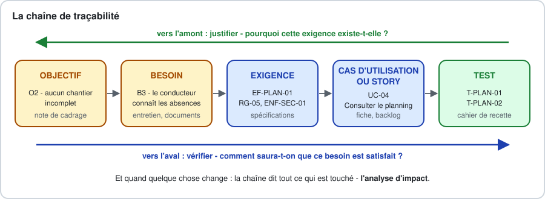
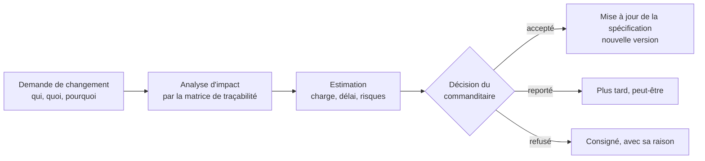

[← Chapitre précédent](02-J1-Atelier-Cadrer-le-besoin.md) · [Sommaire](Readme.md) · [Chapitre suivant →](04-J2-Atelier-Specifier-et-valider.md)

# Jour 2 · Cours - Spécifier

> **Jour 2, matin - 2 h, rappel compris.** Les exemples portent sur le lot 1 du projet Brunel, les exercices sur le lot 2. Cet après-midi, vous transformerez la note de cadrage du lot 2 de votre équipe en dossier de spécifications dans l'[atelier "Spécifier et valider"](04-J2-Atelier-Specifier-et-valider.md).

## 🎯 Objectifs

À la fin de cette matinée, vous saurez :

1. Distinguer les documents de spécification - cahier des charges, spécifications fonctionnelles, spécifications techniques, backlog - et choisir le niveau de détail adapté au projet.
2. Classer les exigences : fonctionnelles, non fonctionnelles selon l'ISO/IEC 25010, contraintes, règles de gestion.
3. Rédiger des exigences non ambiguës, vérifiables et atomiques, à l'aide des gabarits EARS.
4. Décrire un cas d'utilisation sous forme textuelle : scénario nominal, extensions, exceptions.
5. Formaliser des règles de gestion en tables de décision, et décrire les données dans un dictionnaire.
6. Tracer le besoin jusqu'au test, et faire relire, valider, versionner et évoluer une spécification.

## Déroulé de la matinée

| Horaire | Séquence | Durée |
|---|---|---|
| 09:00 | Rappel de la veille | 10 min |
| 09:10 | 1. Qu'est-ce qu'une spécification ? · 2. Les familles d'exigences | 25 min |
| 09:35 | 3. Écrire une bonne exigence, avec l'exercice 1 | 30 min |
| 10:05 | Pause | 15 min |
| 10:20 | 4. Les cas d'utilisation, en texte, avec l'exercice 2 | 20 min |
| 10:40 | 5. Règles de gestion et données, avec l'exercice 3 | 20 min |
| 11:00 | 6. Tracer · 7. Valider et faire vivre la spécification | 15 min |
| 11:15 | *Marge : questions, exercice bonus, ou démarrage anticipé de l'atelier* | *jusqu'à 12:30* |

## Rappel de la veille

Cinq questions, à main levée :

1. Quelle est la différence entre une demande et un besoin ? Donnez l'exemple de Brunel.
2. Pourquoi un objectif SMART n'est-il pas une exigence ?
3. Pourquoi faut-il écrire ce qui est **hors** périmètre ?
4. Qu'est-ce qu'un besoin de base, au sens de Kano, et pourquoi est-il dangereux ?
5. "Jour ouvré" et "jour ouvrable" : quelle différence, et pourquoi le glossaire doit-il trancher ?

<details>
<summary>Voir les réponses</summary>

1. La demande est ce que le client dit vouloir, souvent sous la forme d'une solution : "une appli mobile pour les congés". Le besoin est le problème à résoudre : que les équipes de pose prévues soient complètes, qu'une absence ne soit saisie qu'une fois, que chacun connaisse son solde.
2. Parce qu'il se constate après la mise en service - "moins de 45 min de saisie par semaine" - et qu'il ne dit pas ce que le logiciel doit faire. Les exigences disent ce que le logiciel doit faire pour qu'on atteigne l'objectif.
3. Parce que ce qui n'est pas exclu par écrit sera un jour réclamé comme inclus, et que l'on ne pourra pas prouver le contraire.
4. Un besoin que personne n'exprime parce qu'il va de soi - "le solde est juste" -, mais dont l'absence provoque une insatisfaction forte. Il est dangereux parce qu'on ne le trouve dans aucun compte rendu : c'est à l'équipe de l'écrire.
5. Un jour ouvré est un jour normalement travaillé dans l'entreprise, du lundi au vendredi chez Brunel ; un jour ouvrable va du lundi au samedi, hors jours fériés. Une semaine de congé coûte cinq jours ouvrés ou six jours ouvrables : si le glossaire ne tranche pas, le développeur choisira sans le savoir, et le solde sera faux.

</details>

---

## 1. Qu'est-ce qu'une spécification ?

### 1.1 Une définition de travail

Une **spécification** est la description, validée par ceux qui la commandent et comprise par ceux qui la réalisent, de ce qu'une solution doit faire, des règles qu'elle doit appliquer et des qualités qu'elle doit avoir. Elle sert à quatre choses :

- **un accord** : le client et l'équipe s'entendent sur ce qui sera livré, et sur ce qui ne le sera pas ;
- **une base de conception** : l'architecture, les données et les écrans s'en déduisent ;
- **une base de test** : chaque exigence dit comment on vérifiera qu'elle est satisfaite ;
- **une mémoire** : dans deux ans, quelqu'un se demandera pourquoi le solde est arrondi au demi-jour. La réponse doit être écrite quelque part.

### 1.2 La famille des documents

Le vocabulaire varie d'une entreprise à l'autre. Les rôles, eux, sont stables.

| Document | Qui l'écrit | Ce qu'il dit | Niveau |
|---|---|---|---|
| **Cahier des charges** ou **expression des besoins** | la maîtrise d'ouvrage, parfois aidée d'une AMOA | le contexte, les objectifs, le périmètre, les besoins, les contraintes ; ce que l'on attend, pas comment | le besoin |
| **Spécifications fonctionnelles générales et détaillées** (SFG, SFD) | la maîtrise d'œuvre, validées par la maîtrise d'ouvrage | ce que le système fait, exactement : fonctions, règles de gestion, données, écrans, cas d'erreur | le comportement du système |
| **Spécifications techniques**, dossier d'architecture | la maîtrise d'œuvre | comment le système est construit : architecture, technologies, interfaces, déploiement | la solution technique |
| **Backlog produit**, stories et critères d'acceptation | le *product owner*, avec l'équipe | la même chose que les spécifications fonctionnelles, découpée et ordonnée, détaillée au fil des itérations | le comportement, par petits morceaux |

En France, la norme NF EN 16271 encadre le **cahier des charges fonctionnel** ; à l'international, la norme ISO/IEC/IEEE 29148 décrit les spécifications d'exigences, côté parties prenantes et côté logiciel, et remplace l'ancienne IEEE 830 que vous croiserez encore citée.

Ce module produit l'équivalent de **spécifications fonctionnelles** : c'est ce que votre dossier de projet doit contenir, et c'est ce que vous écrirez le plus souvent en tant que concepteur·rice développeur·se. Les spécifications techniques viendront avec les modules d'architecture.

### 1.3 Spécifier juste assez

Une spécification trop légère laisse chaque développeur deviner ; une spécification trop lourde n'est ni lue ni tenue à jour. Le bon niveau de détail dépend du **risque** qu'on court à ne pas écrire.

| Écrivez davantage quand… | Écrivez moins quand… |
|---|---|
| l'équipe est loin du client : prestataire externe, contrat au forfait | le client est dans l'équipe, chaque jour |
| les règles sont nombreuses, chiffrées, réglementaires : paie, tarifs, droits | le comportement se comprend en le voyant : une maquette suffit |
| une erreur coûte cher : argent, santé, données personnelles | une erreur se corrige vite et sans conséquence |
| plusieurs équipes ou plusieurs systèmes doivent s'accorder | une seule équipe, un seul système |
| le système vivra longtemps, et sera maintenu par d'autres | c'est un prototype jetable |

Chez Brunel, les écrans peuvent rester légers : une maquette et quelques critères d'acceptation. Les **règles de calcul du solde**, l'**export vers la paie** et les **droits d'accès aux absences pour maladie**, eux, doivent être écrits au mot près.

### 1.4 Le plan d'un dossier de spécifications fonctionnelles

Le gabarit [B.14](B-Modeles-et-canevas.md) propose ce plan, que vous suivrez cet après-midi :

1. **Contexte et objectifs** - repris de la note de cadrage.
2. **Glossaire.**
3. **Acteurs et droits** - qui fait quoi, qui voit quoi.
4. **Exigences fonctionnelles** - regroupées par domaine, avec les cas d'utilisation détaillés.
5. **Règles de gestion** - dont les tables de décision.
6. **Données** - dictionnaire des données et, le moment venu, modèle conceptuel.
7. **Exigences non fonctionnelles.**
8. **Interfaces avec les systèmes existants.**
9. **Maquettes** - renvoi aux livrables d'UX.
10. **Traçabilité.**
11. **Questions ouvertes et historique des versions.**

---

## 2. Les familles d'exigences

### 2.1 Quatre familles

Vous connaissez la distinction entre fonctionnel et non fonctionnel. En pratique, on en sépare deux autres familles, parce qu'elles ne se rédigent ni ne se testent de la même manière.

| Famille | Ce qu'elle décrit | Chez Brunel | Se vérifie par |
|---|---|---|---|
| **Exigence fonctionnelle** | ce que le système **fait** : une action, une réaction, un calcul | "Quand un responsable accorde une demande, le système doit l'inscrire dans le planning de l'équipe." | un test fonctionnel |
| **Exigence non fonctionnelle** | une **qualité** du système : performance, sécurité, utilisabilité… | "L'écran de demande s'affiche en moins de 2 secondes sur un smartphone en 4G." | une mesure, un audit, un test spécifique |
| **Contrainte** | une **limite** imposée à la solution, qui ne se discute pas | "Les absences sont transmises au logiciel de paie existant, par import de fichier." | une inspection |
| **Règle de gestion** | une **règle du métier**, vraie avec ou sans logiciel | "Une demande de plus de deux jours ouvrés est déposée au moins quinze jours calendaires avant son début." | des cas de test, un par cas de la règle |

La règle de gestion mérite sa propre famille : elle appartient au **métier**, pas au logiciel. Elle existait sur le papier avant le projet, elle existera après, et elle change au rythme de l'entreprise, pas à celui du code. On l'écrit une fois, on lui donne un identifiant, et les exigences y renvoient.

### 2.2 Les exigences non fonctionnelles : la grille ISO/IEC 25010

Les exigences non fonctionnelles sont celles qu'on oublie. La norme **ISO/IEC 25010**, dans sa version de 2023, fournit une liste de contrôle en neuf caractéristiques de qualité d'un produit logiciel. Parcourez-la pour chaque projet : certaines lignes seront "sans objet", et il faut l'écrire aussi.

| Caractéristique | La question à poser | Chez Brunel |
|---|---|---|
| **Aptitude fonctionnelle** | Les fonctions sont-elles complètes, justes, appropriées ? | le solde affiché est identique à celui du logiciel de paie pour 100 % des salariés au contrôle mensuel |
| **Efficacité de performance** | Temps de réponse, volumes, ressources ? | l'écran de demande s'affiche en moins de 2 s en 4G, pour 95 % des affichages |
| **Compatibilité** | Avec quels systèmes doit-il coexister ou échanger ? | l'export respecte le format d'import d'absences du logiciel de paie en service |
| **Capacité d'interaction** - on disait *utilisabilité* | Peut-on s'en servir facilement, sans erreur, quelle que soit sa situation ? | un salarié qui découvre l'outil pose une demande sans aide en moins de 2 min, vérifié avec cinq salariés ; interface conçue selon le RGAA, niveau AA visé |
| **Fiabilité** | Disponibilité, tolérance aux pannes, récupération ? | disponible 99 % du temps entre 6 h et 20 h en jours ouvrés ; aucune demande déposée n'est perdue |
| **Sécurité** | Confidentialité, intégrité, traçabilité, authentification ? | un responsable ne voit que les absences de son équipe ; le motif et le justificatif d'un arrêt maladie ne sont visibles que de la responsable paie ; chaque décision est horodatée et attribuée |
| **Maintenabilité** | Facile à corriger, à faire évoluer, à tester ? | le délai de prévenance, le seuil d'absents par équipe et les dates de fermeture se modifient par la responsable paie, sans intervention d'un développeur |
| **Flexibilité** - on disait *portabilité* | Sur quels environnements, avec quelle capacité d'adaptation ? | fonctionne sur les deux dernières versions majeures des navigateurs courants, sur ordinateur et smartphone |
| **Sûreté** (*safety*) | Peut-il mettre en danger des personnes, des biens, l'environnement ? | sans objet |

La version précédente de la norme, de 2011, en comptait huit : vous trouverez encore souvent les termes *utilisabilité* et *portabilité*. Les niveaux de service vus en design de service - indicateur, objectif - sont la manière de rendre mesurables les lignes "performance" et "fiabilité".

> **Une exigence non fonctionnelle sans chiffre est un vœu.** "Le système doit être rapide" ne se teste pas. "95 % des affichages en moins de 2 s, mesurés sur un smartphone en 4G" se teste, se négocie et se signe.

### 2.3 Identifier chaque exigence

Une exigence sans identifiant ne peut être ni citée, ni tracée, ni testée. Une convention simple suffit :

| Préfixe | Famille | Exemple |
|---|---|---|
| `EF-<domaine>-nn` | exigence fonctionnelle | `EF-DEM-03` : troisième exigence du domaine "demandes" |
| `ENF-<caractéristique>-nn` | exigence non fonctionnelle | `ENF-SEC-02` |
| `CT-nn` | contrainte | `CT-01` |
| `RG-nn` | règle de gestion | `RG-03` |

Deux règles : un identifiant **ne se réutilise jamais**, même si l'exigence est supprimée - on la marque "abandonnée" ; et chaque exigence porte une **source** - l'entretien, le document, la décision qui la justifie - et une **priorité**, en MoSCoW par exemple.

---

## 3. Écrire une bonne exigence

### 3.1 Les qualités d'une exigence

La norme ISO/IEC/IEEE 29148 énumère les qualités attendues d'une exigence. En voici la version de travail, avec la question qui les vérifie.

| Qualité | La question qui la vérifie | Contre-exemple |
|---|---|---|
| **Nécessaire** | Si on la retire, manque-t-il quelque chose ? À quel objectif ou besoin renvoie-t-elle ? | "Le système doit afficher la météo du chantier." |
| **Non ambiguë** | Deux lecteurs la comprennent-ils de la même façon ? | "Le système doit gérer les demandes." |
| **Vérifiable** | Peut-on écrire un test qui dit oui ou non ? | "L'interface doit être intuitive." |
| **Singulière** | Ne dit-elle qu'une chose ? Un seul "doit" ? | "Le système doit enregistrer la demande et prévenir le responsable et mettre à jour le solde." |
| **Faisable** | Peut-on la réaliser avec ces moyens, ce budget, ces délais ? | "Le système doit fonctionner sans réseau sur les chantiers et se synchroniser instantanément." |
| **Complète** | Dit-elle tout ce qu'il faut, cas d'erreur compris ? | "Le responsable valide la demande." Et s'il refuse ? Et s'il ne répond pas ? |
| **Cohérente** | Ne contredit-elle aucune autre exigence ? | EF-12 "le salarié peut annuler à tout moment" contre RG-09 "une absence accordée ne s'annule qu'avec l'accord du responsable" |
| **Appropriée**, indépendante de la solution | Dit-elle **quoi**, et non **comment** ? | "La demande est stockée dans une table PostgreSQL." |
| **Traçable** | A-t-elle un identifiant et une source ? | une phrase perdue au milieu d'un compte rendu |

### 3.2 Les mots qui piègent

Certains mots signalent presque toujours une exigence défectueuse. Cherchez-les dans votre texte avant toute relecture.

| Mot ou tournure | Le problème | Le remède |
|---|---|---|
| rapide, performant, réactif | non vérifiable | un chiffre, une condition de mesure, un centile |
| facile, intuitif, convivial, ergonomique, moderne | non vérifiable | une tâche, un public, un temps, un taux de réussite |
| sécurisé, robuste, fiable | non vérifiable | quelle menace, quelle règle d'accès, quel taux de disponibilité |
| gérer, traiter, prendre en charge, administrer | ambigu : quelles actions ? | lister les actions : créer, modifier, consulter, supprimer, archiver… |
| etc., notamment, par exemple, … | incomplet | la liste complète, ou une règle qui la définit |
| et/ou | ambigu | deux exigences, ou une règle explicite |
| si possible, éventuellement, idéalement, autant que possible | non engageant | une priorité MoSCoW, et une formulation ferme |
| tous, toujours, jamais, aucun | souvent faux | vérifier les exceptions, et les écrire |
| minimiser, maximiser, optimiser | sans limite | une cible chiffrée |
| l'utilisateur | flou : lequel ? | un acteur du glossaire : le salarié, le responsable d'équipe |
| le système devra permettre de… | inutilement vague | le système doit + verbe d'action |

**Le niveau d'obligation** se dit avec un verbe constant. Une convention répandue, inspirée de la RFC 2119 de l'IETF : **doit** pour l'obligatoire, **devrait** pour le recommandé, **peut** pour le facultatif. Une fois choisie, on ne la varie plus : un "devra" au milieu de "doit" laisse croire à une nuance.

### 3.3 Les gabarits EARS

En 2009, Alistair Mavin et ses collègues de Rolls-Royce ont publié **EARS** - *Easy Approach to Requirements Syntax* -, un petit ensemble de gabarits pour rédiger les exigences en langage naturel sans ambiguïté. Ils sont devenus une référence, des moteurs d'avion aux applications de gestion, parce qu'ils sont simples : chaque gabarit commence par un mot-clé qui dit **quand** l'exigence s'applique.

| Gabarit | Forme | Chez Brunel |
|---|---|---|
| **Permanente** | Le système doit `<réponse>`. | Le système doit décompter les congés payés en jours ouvrés. |
| **Sur événement** | **Quand** `<déclencheur>`, le système doit `<réponse>`. | Quand un responsable d'équipe accorde une demande d'absence, le système doit l'inscrire dans le planning de l'équipe. |
| **Sur état** | **Tant que** `<état>`, le système doit `<réponse>`. | Tant qu'une demande est en attente, le système doit permettre au salarié de l'annuler. |
| **Comportement indésirable** | **Si** `<situation indésirable>`, **alors** le système doit `<réponse>`. | Si le responsable d'équipe n'a pas répondu à une demande trois jours ouvrés après son dépôt, alors le système doit lui adresser une relance. |
| **Optionnelle** | **Lorsque** `<option présente>`, le système doit `<réponse>`. | Lorsque l'export vers le logiciel de paie est activé, le système doit produire le fichier des absences accordées du mois le 25 de chaque mois. |
| **Complexe** | combinaison des précédents | Quand un salarié dépose une demande de congé payé, si son solde prévisionnel à la date de début est insuffisant, alors le système doit refuser le dépôt et indiquer le nombre de jours manquants. |

Trois conseils d'usage :

- **Un déclencheur, une réponse.** Si la réponse contient "et", demandez-vous s'il faut deux exigences.
- **Le gabarit "Si… alors" est le plus précieux** : c'est lui qui force à écrire les cas d'erreur, ceux qu'on oublie.
- **Les termes viennent du glossaire.** "Responsable d'équipe", "demande", "accorder", "solde prévisionnel" : chacun a une définition, et une seule.

### Exercice 1 - Réécrire des exigences (12 min)

En binôme. Voici six exigences trouvées dans le premier jet du cahier des charges du lot 2, écrit au bureau de Brunel avant votre arrivée. Pour chacune : **quel défaut** a-t-elle, et proposez une **réécriture**, avec un gabarit EARS. Vous pouvez la découper en plusieurs exigences, et noter les questions à poser. Les termes viennent du glossaire de l'exercice 3 d'hier : affaire, intervention, prêt à poser.

1. "Le planning doit être clair et accessible partout."
2. "Le système doit gérer les équipes."
3. "Le conducteur doit pouvoir affecter les poseurs et prévenir le client et les poseurs par SMS et/ou WhatsApp."
4. "Les données des poseurs doivent être protégées."
5. "Si possible, le système proposera automatiquement une équipe complète."
6. "Les camions sont suivis en temps réel par GPS, sur une carte Google Maps."

<details>
<summary>Voir la correction</summary>

| # | Défauts | Réécriture possible |
|---|---|---|
| 1 | non vérifiable, double : "clair" et "accessible" ; "partout" ne dit pas où | **ENF-PERF-01** - Le système doit afficher à un poseur ses interventions de la semaine en moins de 3 s pour 95 % des affichages, mesuré sur un smartphone en 4G. **ENF-FIA-01** - Si le réseau est indisponible, alors le système doit afficher au poseur la dernière version reçue de son planning, avec sa date et son heure. *Question : "clair" pour qui ? Le tableau du bureau et l'écran du téléphone n'ont pas le même usage.* |
| 2 | ambigu : "gérer" | **EF-EQU-01** - Le système doit permettre au conducteur de travaux de composer l'équipe d'une intervention, en désignant ses poseurs et son chef de pose. **EF-EQU-02** - Quand le conducteur de travaux compose une équipe, le système doit vérifier les règles de composition et signaler chacune de celles qui ne sont pas respectées. **EF-EQU-03** - Si un poseur affecté à une intervention a une absence accordée pendant cette intervention, alors le système doit le signaler au conducteur de travaux. *Question : les équipes sont-elles fixes pour la saison, ou composées à chaque intervention ?* |
| 3 | non singulière : trois exigences ; "et/ou" ; WhatsApp est une solution, et il passe par les téléphones personnels des poseurs | **EF-AFF-01** - Le système doit permettre au conducteur de travaux d'affecter une équipe et un véhicule à une intervention. **EF-INF-01** - Quand une intervention est planifiée ou modifiée, le système doit en informer chaque poseur de l'équipe. **EF-INF-02** - Quand la date d'une intervention change, le système doit en informer le client le jour même (article 6). *Le canal - SMS, courriel, application - est une question ouverte : quels téléphones, et qui paie ?* |
| 4 | non vérifiable : protégées contre quoi, pour qui ? | **ENF-SEC-01** - Un poseur ne doit accéder qu'aux interventions de ses propres équipes. **ENF-SEC-02** - Les restrictions issues des avis de la médecine du travail ne doivent être consultables que par les conducteurs de travaux, et le système ne doit enregistrer aucun motif médical. **ENF-SEC-03** - Si cinq tentatives de connexion échouent sur un même compte en moins de 15 minutes, alors le système doit suspendre les tentatives pendant 15 minutes. |
| 5 | non engageante : "si possible" ; "automatiquement" cache une décision | **EF-EQU-04** - Quand le conducteur de travaux demande une proposition d'équipe pour une intervention, le système doit lui proposer des poseurs disponibles sur toute la période qui respectent les règles de composition. *Priorité : Could, à faire confirmer. Le conducteur reste celui qui décide.* |
| 6 | une solution, pas une exigence ; une contrainte légale forte ; un besoin inversé pour les poseurs | à supprimer des exigences tant que le besoin n'est pas établi. Si le besoin est de **répondre au client qui demande quand l'équipe arrive**, il s'écrit sans GPS : **EF-INF-03** - Quand le chef de pose indique le départ de l'équipe vers une intervention, le système doit en informer le client, avec une heure d'arrivée estimée. *Question au commanditaire, et au CSE si la géolocalisation est maintenue.* |

Une exigence mal écrite en donne souvent **plusieurs** bonnes, et presque toujours **une question**. C'est le signe qu'elle cachait des décisions non prises. Cet après-midi, à l'étape 7 de l'atelier, ces réécritures sont votre point de départ.

</details>

---

## 4. Les cas d'utilisation, en texte

### 4.1 Pourquoi écrire ce que le diagramme montre déjà ?

En design de service, vous avez dessiné le **diagramme** des cas d'utilisation : qui fait quoi avec le système. Il ne dit rien de **comment** cela se passe, ni de **ce qui peut mal tourner**. La description textuelle, popularisée par Alistair Cockburn dans *Writing Effective Use Cases* (2001), le dit : c'est un récit structuré, étape par étape, de l'interaction entre un acteur et le système pour atteindre un objectif.

Un cas d'utilisation se place au **niveau de l'objectif de l'utilisateur** : une chose qu'il fait en une séance et dont il repart satisfait. "Demander une absence" est à ce niveau ; "Gérer les absences" est trop haut, "Choisir une date" trop bas.

### 4.2 La fiche

| Rubrique | Contenu |
|---|---|
| **Identifiant et nom** | `UC-nn`, un verbe à l'infinitif et un complément : "Demander une absence" |
| **Acteur principal** | celui qui a l'objectif |
| **Acteurs secondaires** | ceux qui interviennent ou sont prévenus |
| **Objectif** | ce que l'acteur principal veut obtenir, en une phrase |
| **Déclencheur** | ce qui lance le cas |
| **Préconditions** | ce qui doit être vrai avant, et que le cas ne vérifie pas lui-même |
| **Garanties en cas de succès** | ce qui est vrai à la fin du scénario nominal |
| **Garanties minimales** | ce qui reste vrai même en cas d'échec |
| **Scénario nominal** | les étapes, numérotées, du cas où tout se passe bien |
| **Extensions** | les variantes et les cas d'erreur, rattachés à l'étape où ils se produisent |
| **Règles de gestion** | les RG appliquées, par leur identifiant |
| **Exigences non fonctionnelles** | celles qui s'appliquent spécifiquement à ce cas |
| **Fréquence** | combien de fois, quand, avec quels pics |
| **Questions ouvertes** | ce qui reste à décider |

### 4.3 Un exemple complet

> **UC-02 - Demander une absence**
>
> **Acteur principal :** salarié · **Acteurs secondaires :** responsable d'équipe, responsable paie
> **Objectif :** faire connaître une absence à venir, et savoir quand elle sera accordée ou refusée.
> **Déclencheur :** le salarié veut s'absenter à une date future.
> **Préconditions :** le salarié est authentifié ; il est rattaché à une équipe qui a un responsable.
> **Garanties en cas de succès :** la demande est enregistrée à l'état "en attente" ; elle apparaît comme "demandée" dans le planning de l'équipe ; le responsable d'équipe en est informé.
> **Garanties minimales :** aucune demande incomplète n'est enregistrée ; le solde n'est pas modifié.
>
> **Scénario nominal**
>
> 1. Le salarié indique qu'il veut demander une absence.
> 2. Le système affiche son solde, son solde prévisionnel, et les absences de son équipe sur les quatre semaines à venir.
> 3. Le salarié indique le type d'absence, la date et la demi-journée de début, la date et la demi-journée de fin.
> 4. Le système calcule le nombre de jours décomptés, vérifie le solde, le délai de prévenance et le nombre d'absents de l'équipe, et affiche le récapitulatif de la demande.
> 5. Le salarié confirme.
> 6. Le système enregistre la demande à l'état "en attente", en informe le responsable d'équipe, et confirme au salarié la date limite de réponse.
>
> **Extensions**
>
> - **4a.** Le solde prévisionnel est insuffisant (RG-07) : le système indique le nombre de jours manquants et propose de demander la différence en congé sans solde. Le salarié modifie sa demande : retour à l'étape 3 ; ou il abandonne.
> - **4b.** Le délai de prévenance n'est pas respecté (RG-03) : le système l'indique et demande un motif. La demande sera transmise à la responsable paie au lieu du responsable d'équipe. Reprise à l'étape 5.
> - **4c.** La période chevauche une absence déjà demandée ou accordée : le système l'indique et affiche l'absence concernée. Retour à l'étape 3.
> - **4d.** Deux membres d'une équipe de fabrication sont déjà absents sur une partie de la période (RG-05) : le système avertit le salarié que l'accord du dirigeant sera nécessaire. Reprise à l'étape 5.
> - **4e.** La période ne compte aucun jour ouvré : le système l'indique. Retour à l'étape 3.
> - **6a.** Le responsable d'équipe est lui-même absent à la date du dépôt : le système informe son suppléant désigné ou, à défaut, le dirigeant.
> - **\*a.** À tout moment avant l'étape 5, le salarié abandonne : rien n'est enregistré.
>
> **Règles de gestion :** RG-01, RG-03, RG-04, RG-05, RG-07 · **Exigences non fonctionnelles :** ENF-PERF-01, ENF-INT-01
> **Fréquence :** environ 400 demandes par an, dont la moitié en mars et en avril.
> **Questions ouvertes :** Q-04 - le suppléant d'un responsable est-il désigné une fois pour toutes, ou pour chaque absence du responsable ?

Remarquez ce que la fiche **ne contient pas** : aucun bouton, aucune couleur, aucun nom d'écran. "Le salarié confirme" survivra à trois refontes de l'interface ; "le salarié clique sur le bouton vert en bas à droite" ne survivra pas à la première. Les écrans sont dans les maquettes, qui renvoient au cas d'utilisation.

### 4.4 Cas d'utilisation, user stories et scénarios Gherkin

Les trois outils ne se concurrencent pas : ils se découpent l'un dans l'autre.

| Dans le cas d'utilisation | Devient | Exemple |
|---|---|---|
| le cas entier | une **epic**, ou une fonctionnalité | "Demander une absence" |
| le scénario nominal | la première **story**, celle qui donne de la valeur | "En tant que salarié, je veux demander une absence pour que mon responsable puisse me l'accorder." |
| une extension qui ajoute de la valeur | une autre story | 4a : "… je veux demander la différence en congé sans solde…" |
| une extension de contrôle | un **critère d'acceptation** | 4c, en Gherkin, ci-dessous |
| une règle de gestion | plusieurs critères d'acceptation, un par cas de la règle | RG-03 : moins de 2 jours, plus de 2 jours, pile 15 jours |

```gherkin
# language: fr
Fonctionnalité: Demander une absence

  Scénario: Une demande qui chevauche une absence déjà accordée est refusée
    Étant donné que Léa a une absence accordée du 14 au 18 avril
    Quand Léa demande une absence du 17 au 22 avril
    Alors la demande n'est pas enregistrée
    Et Léa voit l'absence accordée du 14 au 18 avril
```

### 4.5 Les erreurs fréquentes

| Erreur | À quoi on la reconnaît | Le remède |
|---|---|---|
| Le cas d'utilisation-écran | "UC-05 - Page d'accueil" | un objectif d'acteur, avec un verbe |
| L'interface dans le texte | "il clique", "le menu déroulant" | l'intention : "il choisit", "il indique" |
| Le système acteur principal | "Le système envoie les relances" comme cas déclenché par personne | un acteur temporel - "le temps" ou "l'horloge" -, comme la synchronisation des stocks chez Lucioles |
| Aucune extension | tout se passe toujours bien | à chaque étape du système : "Et si… ?" |
| Les règles recopiées dans le texte | le calcul du solde détaillé à l'étape 4 | un renvoi à la règle de gestion : RG-01, RG-07 |
| Trente étapes | le cas couvre plusieurs objectifs | le découper, ou remonter les détails dans les règles |

### Exercice 2 - Les extensions d'un cas d'utilisation (10 min)

En binôme. Voici le scénario nominal d'un cas d'utilisation du lot 2.

> **UC-14 - Reporter une intervention**
> **Acteur principal :** conducteur de travaux · **Acteurs secondaires :** poseurs de l'équipe, client
>
> 1. Le conducteur de travaux choisit une intervention planifiée et indique qu'il veut la reporter.
> 2. Le système affiche l'intervention, son équipe, son véhicule et l'état de ses menuiseries.
> 3. Le conducteur indique la nouvelle date et la demi-journée de début, et le motif du report.
> 4. Le système vérifie la disponibilité de l'équipe et du véhicule sur la nouvelle période, et affiche le récapitulatif.
> 5. Le conducteur confirme.
> 6. Le système enregistre le report, en informe les poseurs de l'équipe, et informe le client de sa nouvelle date.

Écrivez au moins **cinq extensions**, rattachées à leur étape, et notez les **questions** qu'elles soulèvent.

<details>
<summary>Voir la correction</summary>

- **2a.** L'intervention a déjà commencé : *question* - reporte-t-on ce qui reste à poser, sous la forme d'une nouvelle intervention ? Le cas change de nature.
- **4a.** Un poseur de l'équipe a une absence accordée sur la nouvelle période, dans l'outil du lot 1 : le système l'indique et propose les poseurs disponibles qui respectent les règles de composition. Retour à l'étape 3, ou le conducteur modifie l'équipe.
- **4b.** Le chef de pose n'est pas disponible : l'équipe n'a plus de chef de pose. Le système l'indique ; le conducteur désigne un autre chef de pose, ou change la date.
- **4c.** Le véhicule est déjà affecté sur la nouvelle période : le système propose un autre véhicule adapté - le porteur P1 seulement si un titulaire du permis C1 est dans l'équipe.
- **4d.** La nouvelle date est à moins de cinq jours ouvrés (article 6) : le système avertit le conducteur que le délai d'information du client n'est pas respecté. *Question* - le report est-il permis si c'est le client qui l'a demandé ?
- **4e.** Les menuiseries ne seront pas prêtes à poser la veille de la nouvelle date à 12 heures (article 4) : le système l'avertit.
- **4f.** La nouvelle période ne compte aucun jour ouvré : le système l'indique. Retour à l'étape 3.
- **6a.** Le client ne peut pas être joint par le moyen prévu : le système alerte l'assistante commerciale, qui l'appelle.
- **6b.** Le report est fait le jour même de l'intervention : *question* - faut-il, en plus du message, un appel au client et au chef de pose ?
- **\*a.** À tout moment avant l'étape 5, le conducteur abandonne : rien n'est modifié.

Et une question sur l'étape 3, qui vaut toutes les autres : **le motif du report** est-il un texte libre, ou une liste - menuiseries non prêtes, absence, demande du client, météo ? Sans liste, impossible de mesurer l'objectif "moins de 8 chantiers replanifiés faute de menuiseries prêtes". Une donnée de rien du tout, et c'est l'indicateur du projet qui en dépend.

Six étapes, dix extensions, quatre questions. Le scénario nominal est la partie facile ; la valeur de la fiche est dans les extensions.

</details>

---

## 5. Règles de gestion et données

### 5.1 La règle de gestion

Une règle de gestion s'écrit **du point de vue du métier**, sans référence à l'écran ni au code, et se range dans un catalogue ([B.10](B-Modeles-et-canevas.md)).

| Rubrique | RG-03 chez Brunel |
|---|---|
| **Identifiant** | RG-03 |
| **Nom** | Délai de prévenance |
| **Énoncé** | Une demande de congé de plus de deux jours ouvrés est déposée au moins quinze jours calendaires avant son premier jour. Une demande de deux jours ouvrés ou moins est déposée au moins deux jours ouvrés avant. |
| **Exceptions** | La responsable paie peut accorder une dérogation, sur motif. Les absences pour maladie et pour événement familial ne sont pas soumises au délai. |
| **Exemples** | Demande du 2 avril pour 5 jours à partir du 17 avril : délai respecté (15 jours). Demande du 3 avril pour la même période : délai non respecté. |
| **Source** | règlement intérieur, article 12 ; confirmé par Sandrine le 12 mars |
| **Paramètres** | 2 jours, 15 jours - modifiables par la responsable paie (ENF-MAINT-01) |
| **Utilisée par** | UC-02, EF-DEM-04 |

Les **exemples** sont la rubrique la plus utile. Ils lèvent les ambiguïtés que l'énoncé laisse passer - le délai se compte-t-il jour de dépôt inclus ? - et deviennent les premiers cas de test. C'est l'idée de la **spécification par l'exemple**, développée par Gojko Adzic en 2011 : des exemples concrets, validés par le métier, valent mieux qu'une phrase générale, et ils se transforment directement en tests automatisés.

### 5.2 La table de décision

Quand une règle combine plusieurs conditions, une phrase ne suffit plus. La **table de décision** liste les conditions en lignes, les combinaisons en colonnes, et dit pour chacune quelles actions s'appliquent. Avec *n* conditions binaires, il y a au plus 2ⁿ combinaisons : la table oblige à les examiner **toutes**.

Chez Brunel, le dépôt d'une demande de congé payé :

| | R1 | R2 | R3 | R4 | R5 |
|---|---|---|---|---|---|
| **C1** - Solde prévisionnel suffisant (RG-07) | non | oui | oui | oui | oui |
| **C2** - Délai de prévenance respecté (RG-03) | - | oui | oui | non | non |
| **C3** - Seuil d'absents de l'équipe atteint (RG-05) | - | non | oui | non | oui |
| **A1** - Refuser le dépôt, proposer un congé sans solde | ✓ | | | | |
| **A2** - Transmettre au responsable d'équipe | | ✓ | | | |
| **A3** - Transmettre à la responsable paie, pour dérogation | | | | ✓ | ✓ |
| **A4** - Transmettre au dirigeant, seuil atteint | | | ✓ | | ✓ |

Le tiret "-" signifie que la condition n'a pas d'importance : quand le solde est insuffisant, le reste ne compte plus. Cinq colonnes couvrent ainsi les huit combinaisons.

La colonne R5 est la plus intéressante : délai non respecté **et** seuil atteint. La demande part chez la responsable paie **et** chez le dirigeant. Qui décide le premier ? Que se passe-t-il s'ils ne sont pas d'accord ? Personne n'y avait pensé avant de remplir la table. C'est exactement à cela qu'elle sert.

### 5.3 Le dictionnaire de données

Le dictionnaire décrit chaque donnée que le système manipule : son sens, son format, ses valeurs, ses règles, et sa sensibilité. Il est le pont entre le glossaire, qui définit les notions, et le **modèle conceptuel de données**, que vous construirez dans le module de bases de données. Il prolonge aussi le modèle du domaine dessiné en design de service.

Extrait, pour la **demande d'absence** :

| Donnée | Définition | Type et format | Obligatoire | Valeurs ou règle | Exemple | Donnée personnelle |
|---|---|---|---|---|---|---|
| identifiant | identifiant unique de la demande | texte, `ABS-AAAA-nnnnn` | oui, attribué par le système | unique, jamais réutilisé | ABS-2026-00412 | non |
| salarié | salarié concerné | référence à un salarié | oui | - | Léa Martin | oui |
| type | type d'absence | liste | oui | congé payé, sans solde, événement familial, maladie ; "maladie" saisi par la responsable paie seulement (RG-08) | congé payé | oui ; **sensible** si maladie |
| début | premier jour d'absence | date + demi-journée (matin, après-midi) | oui | jour ouvré | 14/04/2026, matin | oui |
| fin | dernier jour d'absence | date + demi-journée | oui | postérieure ou égale au début | 18/04/2026, après-midi | oui |
| jours décomptés | jours retirés du solde | décimal, au demi-jour | calculé | RG-01 : jours ouvrés, hors jours fériés | 4,5 | oui |
| statut | état de la demande | liste | oui | en attente, accordée, refusée, annulée, enregistrée en paie | accordée | oui |
| motif de refus | raison donnée par le décideur | texte, 500 caractères | si statut "refusée" | RG-04 | "Chantier Dumas, équipe complète requise" | oui |
| justificatif | pièce justificative | fichier PDF ou image, 5 Mo maximum | si type "maladie" | visible de la responsable paie seulement ; durée de conservation : Q-07 | arret.pdf | oui, **sensible** : santé |
| date de dépôt | moment du dépôt | date et heure | oui, attribuée par le système | - | 02/04/2026 08:12 | non |

La dernière colonne n'est pas décorative. Elle alimente directement les exigences de sécurité, le registre des traitements que le RGPD impose de tenir, et les questions de durée de conservation - que l'équipe ne tranche pas seule.

### Exercice 3 - La table de décision d'une équipe (10 min)

En binôme. Reprenez les consignes de pose du lot 2 ([annexe A](A-Projet-Brunel.md), pièce jointe 2) :

- RG-EQU-01 - Une équipe compte au moins deux poseurs, dont un chef de pose (article 1).
- RG-EQU-02 - Lorsque l'intervention nécessite la nacelle, l'équipe compte au moins un titulaire du CACES R486 (article 2).
- RG-EQU-03 - Un intérimaire ne peut pas être chef de pose ; une équipe compte au plus un intérimaire (article 5).
- Décision de Paul Brunel, prise hier soir : "Si une équipe ne respecte pas une consigne, Nadia ou Marc peuvent quand même la valider, en notant pourquoi. Sauf pour la nacelle : sans CACES, jamais."

1. Construisez la **table de décision** de l'affectation d'une équipe : trois conditions, des actions, toutes les combinaisons utiles.
2. Quelle **question** la table fait-elle apparaître ?

<details>
<summary>Voir la correction</summary>

**1. La table.**

| | R1 | R2 | R3 | R4 | R5 |
|---|---|---|---|---|---|
| **C1** - Nacelle nécessaire, sans titulaire du CACES dans l'équipe (RG-EQU-02) | oui | non | non | non | non |
| **C2** - Au moins deux poseurs, dont un chef de pose salarié (RG-EQU-01, RG-EQU-03) | - | oui | non | oui | non |
| **C3** - Au plus un intérimaire (RG-EQU-03) | - | oui | oui | non | non |
| **A1** - Refuser l'affectation | ✓ | | | | |
| **A2** - Accepter l'affectation | | ✓ | | | |
| **A3** - Avertir le conducteur, qui peut valider en indiquant un motif | | | ✓ | ✓ | ✓ |

Le tiret dit que, sans CACES pour une nacelle, le reste ne compte plus. Cinq colonnes couvrent ainsi les huit combinaisons. Remarquez qu'il a fallu écrire C1 "à l'envers" - la situation interdite - pour que la colonne du refus soit lisible.

**2. La question.** Regardez R3 : C2 est faux quand l'équipe n'a **qu'un seul poseur**. La décision de Paul Brunel permet donc à un conducteur de valider une intervention à un seul poseur, en notant un motif. Or c'est exactement ce que le projet veut faire disparaître : quatre chantiers démarrés à un seul poseur l'an dernier, dont un chez le plus gros client. La dérogation s'applique-t-elle aussi à ce cas ? Il faut le lui demander, chiffres en main. D'autres questions sont bienvenues : en R5, deux consignes sont enfreintes à la fois - un motif suffit-il ? Un intérimaire titulaire du CACES peut-il être le seul de l'équipe à conduire la nacelle ?

</details>

---

## 6. Tracer

### 6.1 La chaîne de traçabilité

La **traçabilité** relie chaque élément de la spécification à ce qui le justifie et à ce qui le vérifie.



Elle se lit dans les deux sens :

- **vers l'amont**, pour justifier : pourquoi cette exigence existe-t-elle ? Une exigence qui ne remonte à aucun besoin est candidate à la suppression ;
- **vers l'aval**, pour vérifier : comment saura-t-on que ce besoin est satisfait ? Un besoin qui ne descend vers aucun test n'est pas couvert.

Et elle sert, surtout, à **mesurer l'impact d'un changement** : si RG-03 change, la matrice dit immédiatement quelles exigences, quels cas d'utilisation, quels écrans et quels tests sont touchés.

### 6.2 La matrice

| Objectif | Besoin | Exigence | Cas d'utilisation ou story | Test |
|---|---|---|---|---|
| O2 - aucun chantier incomplet | B3 - le conducteur de travaux connaît les absences accordées de ses poseurs | EF-PLAN-01 - Quand une demande est accordée, le système doit l'inscrire dans le planning de l'équipe. | UC-04 Consulter le planning de l'équipe | T-PLAN-01, T-PLAN-02 |
| O2 | B4 - un salarié sait qui est déjà absent avant de demander | EF-DEM-02 - affichage des absences de l'équipe à la demande | UC-02, étape 2 | T-DEM-02 |
| O1 - une seule saisie | B5 - les absences accordées arrivent en paie sans ressaisie | EF-PAIE-01 - export mensuel au format du logiciel de paie ; CT-01 | UC-07 Exporter les absences du mois | T-PAIE-01 à 05 |
| O3 - aucune erreur de paie | B6 - le solde est juste | EF-SOL-01 ; RG-01, RG-02, RG-07 | UC-02, UC-03 Consulter son solde | T-SOL-01 à 12 |
| - | - | EF-NOT-04 - notifications le week-end | - | - |

La dernière ligne n'a pas d'objectif ni de besoin en amont : quelqu'un l'a ajoutée parce que "c'est bien d'avoir des notifications". La matrice la rend visible. Ici, elle est même contraire à un besoin exprimé par les poseurs : on la supprime.

Pour un petit projet, un tableau suffit. Dans un backlog outillé, la traçabilité se fait par **liens** : la story renvoie à l'exigence, le test automatisé porte l'identifiant de la story dans son nom, le commit cite le ticket.

---

## 7. Valider et faire vivre la spécification

### 7.1 Relire

Une spécification se relit avant d'être validée, et pas par son auteur seulement. Trois relectures, qui ne cherchent pas la même chose :

| Relecture | Par qui | Ce qu'elle cherche |
|---|---|---|
| **Revue par les pairs** | un·e autre membre de l'équipe, ou une autre équipe | les défauts de forme : ambiguïtés, mots pièges, exigences non vérifiables, identifiants manquants ; grille [B.15](B-Modeles-et-canevas.md) |
| **Lecture par un développeur extérieur** | quelqu'un qui n'a assisté à aucun entretien | ce qui ne se comprend pas sans le contexte : "Je ne saurais pas coder ça sans vous poser de question." |
| **Relecture métier** | les experts et le commanditaire | les erreurs de fond : une règle mal comprise, une exception oubliée ; elle se fait **avec des exemples**, pas en lisant les exigences à voix haute |

### 7.2 Faire valider

La validation est l'accord explicite du commanditaire sur une version donnée de la spécification. Elle prend la forme d'un courriel, d'une signature, d'un compte rendu de réunion, ou, en agile, de l'acceptation des stories en revue de sprint. Ce qu'on fait valider : les objectifs, le périmètre, les règles de gestion, les priorités. Ce qu'on ne fait pas valider par le métier : les choix techniques - ce n'est pas son rôle, et il ne peut pas en juger.

### 7.3 Gérer le changement

Une spécification **va** changer. Ce n'est pas un échec : c'est le signe que le client comprend mieux son besoin, ou que le monde a changé. Le problème n'est pas le changement, c'est le changement **non maîtrisé**.



Une demande de changement ([B.16](B-Modeles-et-canevas.md)) dit qui la demande, ce qui change, et pourquoi. L'équipe analyse son impact - exigences, règles, données, écrans, tests, planning - et le commanditaire décide en connaissance de cause. Ce qui n'est pas écrit sera contesté : "Je ne l'ai jamais demandé" ou "C'était évident que c'était inclus".

**Versionnez la spécification comme du code.** En Markdown dans un dépôt Git, chaque modification a un auteur, une date, une raison ; le *diff* montre exactement ce qui a changé entre la version validée et la suivante ; une *pull request* est une revue ; un tag `spec-v1.0` marque la version validée. Tenez aussi, en tête du dossier, un **historique des versions** lisible par le client :

| Version | Date | Auteur | Changements | Validée par |
|---|---|---|---|---|
| 0.1 | 12/03 | équipe | premier jet après cadrage | - |
| 0.2 | 19/03 | équipe | revue croisée ; RG-03 précisée ; Q-02 et Q-03 tranchées | - |
| 1.0 | 26/03 | équipe | version validée | Paul Brunel, courriel du 26/03 |
| 1.1 | 09/04 | équipe | DC-01 : seuil d'absents porté à trois pour l'atelier 1 | Paul Brunel, courriel du 09/04 |

### 7.4 De la spécification à la recette

La boucle se referme à la **recette** : le client vérifie que la solution livrée satisfait la spécification validée. Chaque exigence vérifiable, chaque règle illustrée par des exemples, chaque critère d'acceptation devient un cas du **cahier de recette**. Le procès-verbal de recette dit ce qui est accepté, ce qui l'est avec réserves, ce qui est refusé - et il se signe contre une version précise de la spécification. Vous y reviendrez dans le module consacré aux tests : une spécification vérifiable est la moitié d'un plan de tests.

### Exercice bonus - si la marge le permet (15 min)

Reprenez l'article 4 des consignes de pose du lot 2 : "Un chantier n'est planifié que si le chef d'atelier a déclaré ses menuiseries prêtes, au plus tard la veille à 12 heures." Écrivez-en la règle de gestion, puis **trois scénarios Gherkin** : un cas où la déclaration est faite à temps, un cas où elle ne l'est pas, et un **cas limite** - une intervention qui commence un lundi, déclarée le vendredi à 16 heures. Le cas limite fait-il apparaître une ambiguïté dans l'énoncé de la règle ?

---

## 📁 Dossier de projet

Pour la compétence *Analyser les besoins et maquetter une application*, reprenez dans votre dossier :

- un extrait de la **liste des exigences**, identifiées, priorisées, rédigées avec un gabarit ;
- au moins un **cas d'utilisation détaillé**, extensions comprises ;
- le **catalogue des règles de gestion**, avec au moins une **table de décision** ;
- les **exigences non fonctionnelles**, chiffrées, dont celles de sécurité et de protection des données ;
- un extrait de la **matrice de traçabilité**.

Le **dictionnaire de données** sera le point de départ de votre modèle conceptuel de données, pour la compétence *Concevoir et mettre en place une base de données relationnelle* ; la traçabilité jusqu'aux tests prépare *Préparer et exécuter les plans de tests d'une application*.

Devant le jury, montrez **une** règle de gestion, sa table de décision, et le test qui la vérifie. C'est la preuve la plus courte qui soit que votre code fait ce que le client a demandé.

## Ce qu'il faut retenir

- Une spécification est un accord, une base de conception, une base de test et une mémoire. On en écrit juste assez, selon le risque.
- Quatre familles : exigences fonctionnelles, non fonctionnelles, contraintes, règles de gestion. La règle de gestion appartient au métier.
- Une exigence est nécessaire, non ambiguë, vérifiable, singulière, faisable, et dit quoi, pas comment. Une exigence non fonctionnelle sans chiffre est un vœu.
- EARS : un mot-clé pour dire quand - quand, tant que, si… alors, lorsque -, un "doit" pour dire quoi.
- Un cas d'utilisation textuel vaut surtout par ses extensions, et ne contient aucun bouton.
- Une table de décision oblige à examiner toutes les combinaisons ; c'est dans celles qu'on n'avait pas vues que sont les questions.
- La traçabilité justifie, vérifie, et mesure l'impact d'un changement. Une spécification se versionne comme du code.

## Pour aller plus loin

- Alistair Mavin et al., *Easy Approach to Requirements Syntax (EARS)*, IEEE International Requirements Engineering Conference, 2009 - l'article fondateur, en anglais.
- Alistair Cockburn, *Writing Effective Use Cases*, Addison-Wesley, 2001 - la référence des cas d'utilisation textuels, en anglais.
- Gojko Adzic, *Specification by Example*, Manning, 2011 - spécifier avec des exemples, et en faire des tests, en anglais.
- Karl Wiegers et Joy Beatty, *Software Requirements*, 3e édition, Microsoft Press, 2013 - en particulier les chapitres sur la rédaction des exigences et les règles de gestion.
- ISO/IEC 25010:2023, *Modèle de qualité du produit* ; ISO/IEC/IEEE 29148:2018, *Ingénierie des exigences* - les deux normes citées ce matin.
- OWASP, [*Application Security Verification Standard*](https://owasp.org/www-project-application-security-verification-standard/) - un catalogue d'exigences de sécurité vérifiables, où puiser vos ENF de sécurité.

---

[← Chapitre précédent](02-J1-Atelier-Cadrer-le-besoin.md) · [Sommaire](Readme.md) · [Chapitre suivant →](04-J2-Atelier-Specifier-et-valider.md)
