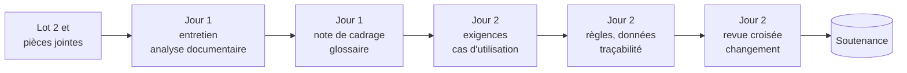

  <picture>
    <source media="(prefers-color-scheme: dark)" srcset="assets/Logo-diginamic-color-blk.png">
    
  </picture>

# Analyse du besoin et spécifications

Deux jours pour apprendre à transformer **ce qu'un client demande** en **ce qu'une équipe peut construire, tester et livrer** : retrouver le besoin derrière la demande, cadrer le projet, recueillir et analyser l'information, puis rédiger des spécifications claires, vérifiables et traçables, et les faire valider. Le cours alterne **apports théoriques** le matin et **atelier en équipe** l'après-midi, sur un fil rouge, et se termine par une **soutenance** du dossier de spécifications.

Vous avez déjà regardé le besoin sous deux angles : celui de l'utilisateur, avec les personas, les parcours et les user stories ; celui du service, avec l'écosystème, le blueprint et les cas d'utilisation. Ce module ajoute le troisième, celui du **concepteur qui s'engage** : qu'est-ce qui est demandé exactement, qu'est-ce qui ne l'est pas, à quelles règles cela obéit, et comment saura-t-on que c'est fait ?

## 🎯 Objectifs pédagogiques

À la fin de ces deux jours, vous saurez :

1. Distinguer une demande, un besoin, une exigence et une solution, et remonter de la demande d'un client au problème qu'elle doit résoudre.
2. Cadrer un projet : énoncé du problème, objectifs mesurables, périmètre, contraintes, hypothèses et risques.
3. Choisir et mener les techniques de recueil adaptées - entretien de cadrage, analyse documentaire, observation, atelier - et repérer les besoins que personne n'exprime.
4. Construire un glossaire métier et lever les ambiguïtés du vocabulaire.
5. Classer et rédiger des exigences fonctionnelles et non fonctionnelles non ambiguës et vérifiables, à l'aide de gabarits.
6. Décrire un cas d'utilisation sous forme textuelle, formaliser des règles de gestion en tables de décision et tenir un dictionnaire de données.
7. Assurer la traçabilité du besoin jusqu'au test, et faire relire, valider et évoluer une spécification.

## ❔ Pourquoi ce cours ?

"Il nous faut une application mobile pour les congés." Une équipe peut la livrer en six semaines, propre, testée, bien notée sur les stores… et découvrir à la première paie que le service RH ressaisit toujours tout, parce que personne n'a demandé comment les absences arrivaient dans le logiciel de paie. Le code était bon. La compréhension, non.

Les études sur les projets informatiques le répètent depuis trente ans : parmi les premières causes d'échec ou de dérive, on trouve des exigences incomplètes, mal comprises ou instables, et des utilisateurs trop peu associés. Une erreur de compréhension coûte d'autant plus cher qu'on la découvre tard : une phrase à corriger pendant le cadrage, un écran à refaire après la maquette, une fonctionnalité à reconstruire après la mise en production.

Pour un·e concepteur·rice développeur·se, la spécification n'est pas un document administratif. C'est **la base de tout le reste** : l'architecture se justifie par les exigences, la base de données se déduit du dictionnaire de données, les tests se dérivent des critères d'acceptation, et la recette se signe contre la spécification validée.

**Au regard du titre professionnel Concepteur développeur d'applications (RNCP37873)**, ce module travaille directement des compétences évaluées :

| Bloc | Compétence | Ce que le module y apporte |
|---|---|---|
| BC02 - Concevoir et développer une application sécurisée organisée en couches | Analyser les besoins et maquetter une application | cadrage, recueil, glossaire, exigences, cas d'utilisation textuels, règles de gestion |
| BC02 - Concevoir et développer une application sécurisée organisée en couches | Concevoir et mettre en place une base de données relationnelle | dictionnaire de données, règles de gestion, point de départ du modèle conceptuel de données |
| BC01 - Développer une application sécurisée | Contribuer à la gestion d'un projet informatique | périmètre, risques, validation, gestion des demandes de changement |
| BC03 - Préparer le déploiement d'une application sécurisée | Préparer et exécuter les plans de tests d'une application | exigences vérifiables, traçabilité jusqu'au test, critères de recette |

À l'examen, ces compétences sont évaluées à partir du **dossier de projet**, de sa **présentation au jury** et d'un **entretien technique**. Le dossier présente l'expression des besoins et les spécifications du projet : ce que vous produisez pendant ces deux jours en est le modèle. Les sections 📁 *Dossier de projet* des chapitres de cours disent quoi en reprendre. Le glossaire de l'[annexe C](C-Glossaire-et-ressources.md) donne les équivalents anglais de tout le vocabulaire : la littérature de l'ingénierie des exigences est très largement anglophone.

## Public et prérequis

- Apprenant·e·s du titre **Concepteur développeur d'applications** (CDA), en début de formation.
- Avoir suivi les modules **UX, user stories et maquettage** et **Conception et design de service**, ou en connaître l'essentiel : persona, parcours, user story et critères d'acceptation, MoSCoW, écosystème, blueprint, diagramme de cas d'utilisation. Le cours les rappelle au moment où il s'en sert.
- Aucune connaissance de programmation n'est nécessaire : on écrit du français, précis.
- Un ordinateur portable avec un navigateur récent et un éditeur de texte qui affiche le Markdown.

## Organisation des deux jours

### Une journée de 5 heures dans une journée de 7 heures

Chaque journée prévoit **5 heures d'activités** sur une présence de 7 heures. Les deux heures restantes ne sont pas du temps perdu : ce sont les pauses, les retards du matin, la question qui mérite vingt minutes, le débat d'équipe qu'il ne faut pas couper. La marge est placée **en fin de demi-journée**. Si tout va bien, elle sert à lancer l'atelier plus tôt, à faire les exercices bonus ou à approfondir un livrable.

### Le déroulé

| Quand | Horaire indicatif | Séquence | Durée prévue |
|---|---|---|---|
| **Jour 1** | 09:00 | Ouverture : tour de table, présentation du module et du fil rouge | 15 min |
| | 09:15 | Cours 1, première partie | 55 min |
| | 10:10 | Pause | 15 min |
| | 10:25 | Cours 1, seconde partie, avec exercices | 65 min |
| | 11:30 - 12:30 | *Marge* | *jusqu'à 1 h* |
| | 13:30 | Atelier, partie 1 : cadrer le besoin (pause de 10 minutes incluse) | 2 h 25 |
| | 15:55 | Restitution, puis bilan de la journée | 30 min |
| | 16:25 - 17:00 | *Marge* | *jusqu'à 35 min* |
| **Jour 2** | 09:00 | Rappel de la veille | 10 min |
| | 09:10 | Cours 2, première partie | 55 min |
| | 10:05 | Pause | 15 min |
| | 10:20 | Cours 2, seconde partie, avec exercices | 55 min |
| | 11:15 - 12:30 | *Marge, ou démarrage anticipé de l'atelier* | *jusqu'à 1 h 15* |
| | 13:30 | Atelier, partie 2 : spécifier et valider (pause de 10 minutes incluse) | 2 h 25 |
| | 15:55 | Soutenance, puis bilan du module | 45 min |
| | 16:40 - 17:00 | *Marge* | *jusqu'à 20 min* |

Les horaires sont indicatifs : ce sont les durées qui comptent.

### Les quatre demi-journées

| Demi-journée | Cours | Atelier | Ce que l'équipe montre |
|---|---|---|---|
| **Jour 1, matin** | Analyser le besoin : demande, besoin, exigence ; rôles ; cadrage ; techniques de recueil ; besoins implicites ; glossaire métier | - | - |
| **Jour 1, après-midi** | - | Cadrer le lot 2 du projet Brunel : entretien avec le commanditaire, analyse des pièces jointes, objectifs, périmètre, glossaire, note de cadrage | Restitution : le problème réel, l'objectif principal, ce qui est hors périmètre et pourquoi |
| **Jour 2, matin** | Spécifier : documents de spécification, familles d'exigences, rédaction, cas d'utilisation textuels, règles de gestion, données, traçabilité, validation | - | - |
| **Jour 2, après-midi** | - | Spécifier et valider : exigences, cas d'utilisation, règles et données, exigences non fonctionnelles, traçabilité, revue croisée, demande de changement | Soutenance : de la demande au dossier de spécifications |

### Le fil rouge

Un seul projet pendant les deux jours, avec un seul commanditaire : **l'Atelier Brunel**, une entreprise de menuiserie de soixante-deux salarié·e·s, et son dirigeant, Paul Brunel ([annexe A](A-Projet-Brunel.md)). Le projet a deux lots :

- le **lot 1, les absences** - "une application pour les congés" -, sert d'exemple dans le cours : on vous montre la démarche complète sur lui ;
- le **lot 2, le planning des chantiers de pose**, est le sujet des exercices du matin et des ateliers de l'après-midi : vous l'exercez par morceaux le matin, la correction se fait ensemble, et l'atelier repart de là.

Le groupe travaille en **deux équipes de trois**, sur le même lot, avec le même commanditaire : les entretiens se font ensemble, et chaque équipe produit son propre dossier. Le deuxième jour, chaque équipe relit celui de l'autre, et les deux soutenances se comparent. Les ateliers sont minutés pour cette configuration ; le [guide d'animation](formateur/Guide-animation.md) donne les ajustements pour un groupe plus nombreux. Le lot 2 est accompagné de **pièces jointes** - un courriel du commanditaire, une note de service, la transcription du tableau blanc des chantiers, des verbatims - qu'il faudra analyser comme on analyse les documents d'un vrai client. Chaque étape part des livrables de la précédente : le glossaire nomme les données, les règles extraites des pièces jointes deviennent des règles de gestion, les objectifs justifient les exigences, et les exigences se tracent jusqu'aux tests.

Quatre autres sujets, avec leurs pièces jointes, sont fournis dans l'[annexe D](D-Briefs-entrainement.md) pour s'entraîner après le module.

## Le parcours

Chaque séquence est un fichier. On les suit **dans l'ordre** : chaque atelier s'appuie sur le cours qui le précède et sur les livrables de l'étape d'avant.

| # | Séquence | Quand | Durée | Ce qu'on y fait |
|---|---|---|---|---|
| [01](01-J1-Cours-Analyser-le-besoin.md) | Analyser le besoin | J1 matin | 2 h 15 | demande, besoin, exigence, solution ; rôles ; cadrage et objectifs SMART ; techniques de recueil et analyse documentaire ; modèle de Kano ; glossaire métier |
| [02](02-J1-Atelier-Cadrer-le-besoin.md) | Atelier, partie 1 : cadrer le besoin | J1 après-midi | 2 h 25 + 30 min | entretien avec le commanditaire, analyse documentaire, tableau blanc, problème et objectifs, périmètre, glossaire, note de cadrage, restitution |
| [03](03-J2-Cours-Specifier.md) | Spécifier | J2 matin | 2 h | documents de spécification, familles d'exigences, ISO 25010, rédaction et gabarits EARS, cas d'utilisation textuels, règles de gestion et tables de décision, dictionnaire de données, traçabilité, validation et changement |
| [04](04-J2-Atelier-Specifier-et-valider.md) | Atelier, partie 2 : spécifier et valider | J2 après-midi | 2 h 25 + 45 min | exigences, cas d'utilisation, règles et données, exigences non fonctionnelles, matrice de traçabilité, revue croisée, analyse d'impact, soutenance |
| [A](A-Projet-Brunel.md) | Le projet Brunel | J1 → J2 | - | le lot 2, sujet des exercices et des ateliers, et ses pièces jointes |
| [B](B-Modeles-et-canevas.md) | Modèles et canevas | J1 → J2 | - | gabarits de cadrage, d'exigence, de cas d'utilisation, de règle, de dictionnaire, de traçabilité ; grilles de revue, de retours et d'évaluation |
| [C](C-Glossaire-et-ressources.md) | Glossaire et ressources | - | - | vocabulaire français / anglais, normes, références, outils |
| [D](D-Briefs-entrainement.md) | Briefs pour s'entraîner | après le module | - | quatre autres sujets, avec leurs pièces jointes |

## Outils et matériel

| Besoin | Outil conseillé | Alternative |
|---|---|---|
| Tri, cartographies, ateliers | post-its, feutres, grandes feuilles | un tableau blanc partagé : Miro, FigJam, ou [Excalidraw](https://excalidraw.com) sans compte |
| Dossier de spécifications | un dépôt Git d'équipe, en Markdown : un fichier par partie du dossier | un document partagé, avec l'historique des versions activé |
| Tableaux : exigences, règles, dictionnaire, traçabilité | des tableaux Markdown, ou un tableur partagé | - |
| Diagrammes | [Mermaid](https://mermaid.js.org/), rendu directement par GitHub | [PlantUML](https://plantuml.com/fr/), [draw.io](https://app.diagrams.net/) |

**Pourquoi Markdown et Git ?** Parce qu'une spécification est un document qui **change**. Dans un dépôt, chaque modification a un auteur, une date et une raison ; une revue se fait dans une *pull request* ; une version validée se marque d'un tag. C'est exactement ce qu'on attend de la gestion d'une spécification, avec les outils que vous utiliserez tous les jours.

Chaque équipe tient aussi son **journal de décisions** ([B.1](B-Modeles-et-canevas.md)) : chaque décision importante, sa raison, la date, qui l'a prise. Photographiez les supports papier : ils iront dans votre dossier de projet.

## Évaluation

- **En fin de premier jour**, la restitution est formative : elle ne note pas, elle fait progresser. L'autre équipe et le formateur font leurs retours avec la grille "j'ai aimé / je me demande / je propose" de l'[annexe B](B-Modeles-et-canevas.md).
- **En fin de deuxième jour**, la soutenance et le dossier de spécifications sont évalués avec la grille de l'annexe B, construite sur les attendus des compétences visées : besoin reformulé et justifié, périmètre explicite, exigences non ambiguës et vérifiables, règles de gestion complètes, données décrites, exigences non fonctionnelles mesurables - sécurité et données personnelles comprises -, traçabilité du besoin au test, prise en compte de la revue et du changement.

## Pour le formateur

Le dossier `formateur/` contient le [guide d'animation](formateur/Guide-animation.md) : déroulé minuté, consignes, points de vigilance, la fiche du commanditaire - ce que Paul Brunel révèle quand on l'interroge -, la demande de changement à remettre le deuxième jour, repères de correction, et ce qu'on fait de la marge. Ce fichier n'est pas repris dans le support PDF.
