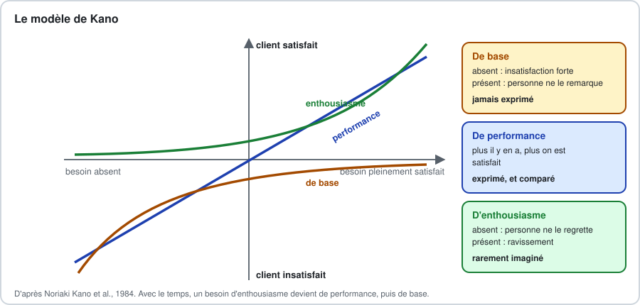
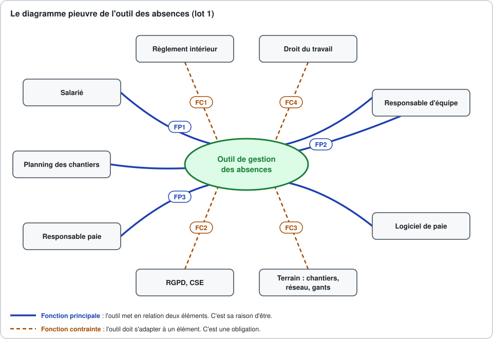
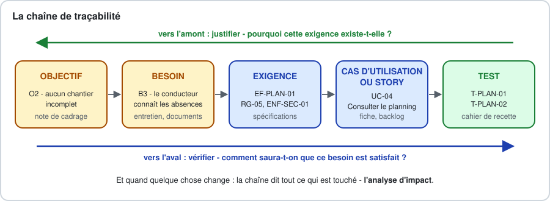

# Analyse du besoin et spécifications

### De ce que le client demande à ce que l'équipe peut construire

2 jours · Concepteur développeur d'applications

<!-- Diapositive d'ouverture. Avant de commencer : minuteur prêt, dossier du lot 2 imprimé, tableau blanc agrandi en A3, fiche de Paul Brunel et demande de changement à portée de main. Annoncer le principe de la marge. -->

---

## 🎯 Objectifs pédagogiques

<style scoped>section { font-size: 28px }</style>

À la fin de ces deux jours, vous saurez :

1. Distinguer demande, besoin, exigence et solution
2. Cadrer un projet : problème, objectifs, périmètre, contraintes, risques
3. Recueillir le besoin, analyse documentaire comprise, et trouver ce que personne ne dit
4. Construire un glossaire métier
5. Rédiger des exigences non ambiguës et vérifiables
6. Écrire des cas d'utilisation, des règles de gestion, un dictionnaire de données
7. Tracer jusqu'au test ; faire relire, valider, évoluer une spécification

---

## Le troisième angle

| Module | L'angle | Ce que vous en avez gardé |
|---|---|---|
| UX et maquettage | l'**utilisateur** | personas, parcours, user stories, Gherkin, MoSCoW |
| Design de service | le **service** | écosystème, blueprint, cas d'utilisation, niveaux de service |
| **Ce module** | le **concepteur qui s'engage** | ce qui est demandé, ce qui ne l'est pas, les règles, et comment on saura que c'est fait |

> Passer de "comprendre" à "s'engager".

---

## Les deux jours

| Demi-journée | Contenu |
|---|---|
| **J1 matin** | Cours - Analyser le besoin |
| **J1 après-midi** | Atelier - Cadrer le besoin, puis restitution |
| **J2 matin** | Cours - Spécifier |
| **J2 après-midi** | Atelier - Spécifier et valider, puis soutenance |

**5 heures d'activités par jour, sur 7 heures de présence.** La marge est en fin de demi-journée : si on ne la consomme pas, on avance.

---

## Un projet, un commanditaire

<style scoped>section { font-size: 28px }</style>

**L'Atelier Brunel** - une menuiserie de 62 personnes · Paul Brunel, dirigeant

| | Lot 1 - Les absences | Lot 2 - Le planning des chantiers |
|---|---|---|
| **Le matin, dans le cours** | les exemples | les exercices |
| **L'après-midi, en atelier** | - | votre travail, en deux équipes de trois |

> On vous montre la démarche sur le lot 1, vous l'exercez sur le lot 2, la correction se fait ensemble, et l'atelier repart de là.

Le dossier du lot 2 : **annexe A**. Quatre autres sujets pour s'entraîner : annexe D.

---

## Pourquoi ce cours ?

<style scoped>section { font-size: 28px }</style>

- Une application peut être bien codée… et ne servir à rien
- Les exigences incomplètes ou mal comprises sont parmi les premières causes d'échec des projets
- Plus une erreur de compréhension est découverte tard, plus elle coûte cher

**Au regard du titre CDA :**
- BC02 - *Analyser les besoins et maquetter une application*
- BC02 - *Concevoir et mettre en place une base de données relationnelle*
- BC01 - *Contribuer à la gestion d'un projet informatique*
- BC03 - *Préparer et exécuter les plans de tests d'une application*

---

# Jour 1

### Analyser le besoin

---

## Pour commencer

> Une fois où vous avez livré - ou reçu - autre chose que ce qui était attendu.

<!-- Tour de table, une phrase par personne. Noter les réponses : on y revient en partie 1.3. -->

---

## L'Atelier Brunel

<style scoped>section { font-size: 28px }</style>

- 38 personnes à l'atelier, 16 poseurs en binômes sur les chantiers, 8 au bureau
- Formulaire papier → signature du responsable → tableur de Sandrine → logiciel de paie
- Le planning des chantiers tient sur un tableau blanc

> "Il nous faudrait une appli mobile pour les congés, comme chez les grands groupes, avec des notifications. Vous pouvez nous faire ça pour la rentrée ?"
> \- Paul Brunel, dirigeant

---

# 1. Demande, besoin, exigence, solution

---

## Quatre mots

<style scoped>section { font-size: 26px }</style>

| Mot | Ce que c'est | Chez Brunel |
|---|---|---|
| **Demande** | ce que le client dit vouloir | "une appli mobile pour les congés" |
| **Besoin** | le problème à résoudre, sans solution | savoir qui sera absent pour planifier ; une seule saisie ; connaître son solde |
| **Exigence** | ce que la solution doit faire, vérifiable | "Quand un responsable accorde une demande, le système doit l'inscrire dans le planning." |
| **Solution** | la manière d'y répondre | une application web, un export vers la paie |

> Le besoin est ce qui reste quand on retire la solution de la demande.

---

## Les cinq pourquoi

<style scoped>section { font-size: 28px }</style>

1. Pourquoi une appli ? - "Le papier, ça se perd."
2. Pourquoi est-ce un problème ? - "Personne ne sait que le gars est en congé."
3. Pourquoi faut-il le savoir ? - "Le conducteur de travaux prévoit ses équipes."
4. Et quand il ne le sait pas ? - "Le chantier démarre à un seul poseur. Quatre fois l'an dernier."
5. Ça vous coûte quoi ? - "Des pénalités, et un client qui hésite à revenir."

**Le besoin :** que les équipes de pose prévues soient complètes.

<!-- Variez la forme : "Qu'est-ce qui se passe quand… ?", "Racontez-moi la dernière fois que…". Le même exercice avec Sandrine mène ailleurs : trois heures de ressaisie par semaine, deux erreurs de paie. -->

---

## Pourquoi c'est votre affaire

- Le dessin de la balançoire : ce que le client a demandé… et ce dont il avait besoin
- **Boehm, 1981** : le coût d'un défaut croît avec la phase où on le découvre
- **Standish Group, 1994** : implication des utilisateurs, exigences incomplètes, exigences instables - en tête des causes de dérive
- Livrer exactement la demande ne protège pas le développeur
- Le jury vous demandera **pourquoi**

---

# 2. Qui analyse le besoin, et quand

---

## Les rôles

<style scoped>section { font-size: 24px }</style>

| Rôle | Ce qu'il apporte | Chez Brunel |
|---|---|---|
| **Commanditaire** | objectifs, budget, arbitrage | Paul Brunel |
| **Maîtrise d'ouvrage** (MOA) | le besoin, les règles, la recette | l'Atelier Brunel |
| **Experts métier** | règles, exceptions | Sandrine, le conducteur de travaux |
| **Utilisateurs finaux** | l'usage réel | salariés, responsables d'équipe |
| **Maîtrise d'œuvre** (MOE) | faisabilité, coûts, alternatives | votre équipe |
| ***Product owner*** | vision, ordre du backlog | - |

> Qui a le droit de dire ce qui est demandé, et qui a le droit de dire que c'est fait ?

---

## Une activité, pas une phase

**Cadrer** → **Recueillir** → **Analyser** → **Spécifier** → **Valider** → … et on recommence

- **Cycle en V** : surtout avant la conception ; risque de figer trop tôt
- **Agile** : à chaque itération ; risque de ne jamais rien écrire
- Dans les deux cas : **le cadrage se fait au début, et il se fait bien**

---

# 3. Cadrer le projet

---

## L'énoncé du problème

<style scoped>section { font-size: 28px }</style>

> **Le problème de** la circulation des demandes d'absence, sur papier et par ressaisies,
> **affecte** les conducteurs de travaux, la responsable paie et tous les salariés,
> **ce qui a pour conséquence** quatre chantiers incomplets, 3 h de ressaisie par semaine, deux erreurs de paie en un an.
> **Une solution réussie permettrait de** connaître les absences dès leur accord, de ne les saisir qu'une fois, et de donner à chacun son solde.

Gabarit de la méthode RUP. S'il contient "application", il contient une solution.

---

## QQOQCCP

<style scoped>section { font-size: 26px }</style>

| | Ce qu'on sait | Ce qu'on ne sait pas encore |
|---|---|---|
| **Qui ?** | 62 salariés, 5 responsables, Sandrine | les intérimaires ? |
| **Quoi ?** | congés, maladie, événements familiaux | les heures récupérées ? |
| **Où ?** | atelier, chantiers, domicile | smartphones ? réseau sur les chantiers ? |
| **Quand ?** | toute l'année, pic en mars-avril | la fermeture d'août ? |
| **Comment ?** | papier, tableur, logiciel de paie | le logiciel de paie importe-t-il ? |
| **Combien ?** | 400 demandes par an | quel budget ? |

La dernière colonne devient la liste des questions de l'entretien.

---

## La bête à cornes

- **À qui rend-il service ?** aux salariés, aux responsables d'équipe, à la responsable paie
- **Sur quoi agit-il ?** les demandes d'absence et le planning des équipes
- **Dans quel but ?** que chaque absence, demandée une seule fois, soit connue à temps de ceux qui planifient et de ceux qui paient

> Si la case "dans quel but ?" contient une solution, le besoin n'est pas compris.

---

## Des objectifs SMART

<style scoped>section { font-size: 28px }</style>

**S**pécifique · **M**esurable · **A**tteignable · **R**éaliste · **T**emporellement défini - George T. Doran, 1981

| Mal formulé | SMART |
|---|---|
| "Moderniser la gestion des congés." | "D'ici au 31 mars, plus aucune absence n'est saisie deux fois : de 3 h à moins de 45 min par semaine." |
| "Améliorer la planification." | "D'avril à octobre, aucun chantier ne démarre incomplet du fait d'une absence accordée - contre quatre." |

- Un objectif **n'est pas** une exigence : il se constate après la mise en service
- Sans valeur de départ, pas d'objectif

---

## Le périmètre

| Dans le périmètre | **Hors périmètre** | Plus tard, peut-être |
|---|---|---|
| demander, accorder, refuser, annuler | **le calcul de la paie** | les heures récupérées |
| consulter son solde | **les notes de frais** | l'application native |
| le planning des absences | **la planification des chantiers** | les intérimaires |
| l'export vers la paie | **les entretiens annuels** | - |

> Ce qui n'est pas écrit comme exclu sera un jour réclamé comme inclus.

---

## Contraintes, hypothèses, risques

<style scoped>section { font-size: 28px }</style>

- **Contraintes** - droit du travail ; RGPD : un arrêt maladie est une donnée de santé ; CSE ; logiciel de paie existant ; septembre
- **Hypothèses** - "Tous les salariés ont accès à un smartphone ou à un poste."
- **Risques** - probabilité, impact, réponse

| Risque | P. | I. | Réponse |
|---|---|---|---|
| Les poseurs n'utilisent pas l'outil | moy. | fort | les associer ; saisie par le conducteur |
| L'import en paie ne marche pas | moy. | fort | vérifier le format **avant** de spécifier |

---

## Exercice 1 - Cadrer le lot 2

<style scoped>section { font-size: 26px }</style>

> "On voudrait faire pareil pour le planning des chantiers. Un grand tableau sur écran, que tout le monde puisse voir sur son téléphone, avec le GPS des camions. Nadia et Marc passent leur vendredi après-midi à refaire le planning. Et l'été, avec les intérimaires, c'est la pagaille." - Paul Brunel

37 chantiers replanifiés à moins de 48 h, dont 22 faute de menuiseries prêtes · 4 h de planning par conducteur chaque vendredi · 14 réclamations de clients

1. Isolez la **solution** et les **problèmes**
2. Écrivez l'**énoncé du problème**
3. Proposez **deux objectifs SMART**
4. Citez **trois éléments hors périmètre**

**10 minutes, en binôme**

---

## Correction - Exercice 1 (1/2)

<style scoped>section { font-size: 24px }</style>

1. **La solution :** un écran, le téléphone, le GPS des camions.
   **Les problèmes :** les conducteurs perdent leur vendredi à refaire le planning. Ils s'appellent sans cesse. L'été, c'est la pagaille. Les faits en ajoutent un : des chantiers replanifiés au dernier moment, faute de menuiseries prêtes.

2. **L'énoncé du problème :**
   > **Le problème de** la planification des chantiers sur un tableau blanc, sans lien avec la fabrication ni les absences,
   > **affecte** les conducteurs, les poseurs et les clients,
   > **ce qui a pour conséquence** 37 chantiers replanifiés à moins de 48 h et 14 réclamations.
   > **Une solution réussie permettrait de** n'envoyer que des équipes complètes sur des menuiseries prêtes.

<!-- Faire lire deux énoncés de binômes avant d'afficher celui-ci. Il est repris à l'étape 3 de l'atelier. -->

---

## Correction - Exercice 1 (2/2)

<style scoped>section { font-size: 26px }</style>

3. **Deux objectifs SMART :**
   - D'avril à octobre, moins de 8 chantiers replanifiés faute de menuiseries prêtes, contre 22.
   - Dès mai, le planning de la semaine prend moins de 1 h 30 par conducteur, contre 4 h.

4. **Trois éléments hors périmètre :**
   - la planification de la fabrication ;
   - la géolocalisation des véhicules ;
   - la facturation.

> Le GPS ne répond à aucun des problèmes. Il faut demander à Paul à quoi il servirait.

---

# 4. Recueillir le besoin

---

## Panorama des techniques

<style scoped>section { font-size: 28px }</style>

| Technique | Ce qu'elle voit | Sa limite |
|---|---|---|
| Entretien de cadrage | objectifs, priorités, contraintes | ce que le commanditaire imagine |
| Entretien d'expert | règles, exceptions | il oublie l'évidence |
| Observation | ce que les gens font vraiment | du temps |
| Atelier collectif | désaccords, arbitrages | les voix fortes |
| **Analyse documentaire** | données, règles, volumes | l'écrit n'est pas toujours appliqué |
| Questionnaire | des réponses nombreuses | ce qu'on a pensé à demander |
| Prototype | une réaction concrète | "c'est presque fini" |

---

## L'analyse documentaire

<style scoped>section { font-size: 26px }</style>

Demandez **tous** les documents :

- **formulaires** : chaque champ est une donnée, chaque case une liste, chaque signature une étape
- **tableurs** : chaque colonne une donnée, chaque formule une règle, chaque cellule colorée une règle non écrite
- **règlements, procédures** : des règles de gestion, déjà rédigées
- **courriers types** : les futures notifications
- **exports** : formats, identifiants, contraintes d'intégration
- **réclamations, statistiques** : volumes, pics, ce qui casse

> Demandez à voir **vingt formulaires remplis** : les exceptions sont dans les marges.

---

## Le formulaire de Brunel

<style scoped>section { font-size: 28px }</style>

| Ce qu'on y lit | Ce qu'on en tire |
|---|---|
| **Données** | salarié, équipe, type, début et fin à la demi-journée, nb de jours, décision, solde avant et après |
| **Étapes** | le salarié demande → le responsable accorde → la RH met à jour et saisit en paie |
| **Règles** | demi-journées ; décompte du solde |
| **Questions** | Qui calcule le "nb de jours" ? Les samedis ? Que contient "autre" ? Où est la maladie ? Le refus est-il motivé ? Et si le responsable est absent ? |

---

## L'entretien de cadrage

<style scoped>section { font-size: 28px }</style>

| Pour obtenir… | Demandez… |
|---|---|
| les objectifs | "Dans un an, qu'est-ce qui vous ferait dire que c'était réussi ?" |
| l'existant | "Montrez-moi comment vous faites." |
| les règles | "Comment décidez-vous de… ? Qui a le droit de… ?" |
| **les exceptions** | "Et quand ça ne se passe pas comme d'habitude ?" |
| les volumes | "Combien, en période de pointe ?" |
| les limites | "Qu'est-ce qui ne doit surtout pas arriver ?" |

**Reformuler** · **demander des exemples chiffrés** · **écrire et faire valider le jour même**

---

## Les pièges du recueil

- **La solution déguisée** - "comme chez…"
- **L'évidence tacite** - "c'est évident"
- **Le commanditaire n'est pas l'utilisateur**
- **Le cas général seulement**
- **Tout est prioritaire**
- **Les demandes contradictoires** - à faire arbitrer
- **La règle écrite mais morte**

> "Nous savons plus que nous ne pouvons dire." - Michael Polanyi, 1966

---

## Exercice 2 - Les consignes de pose

<style scoped>section { font-size: 26px }</style>

- **Art. 1** - Au moins deux poseurs par chantier, dont un chef de pose, qui répond du chantier auprès du client.
- **Art. 4** - Un chantier n'est planifié que si le chef d'atelier a déclaré ses menuiseries prêtes, au plus tard la veille à 12 h.
- **Art. 5** - Un intérimaire ne peut pas être chef de pose. Au plus un intérimaire par équipe.
- **Art. 6** - Le client est informé de la date au moins cinq jours ouvrés avant. Tout changement lui est signalé le jour même.

1. Les **données** · 2. Les **règles**, une par ligne · 3. Au moins **cinq questions**

**10 minutes, en binôme**

---

## Correction - Exercice 2 (1/2)

<style scoped>section { font-size: 24px }</style>

1. **Les données :** le poseur (chef de pose ou non, salarié ou intérimaire) · le chantier (dates, équipe, client) · les menuiseries (prêtes ou non, date et heure de la déclaration) · le client (comment le joindre).

2. **Les règles :**
   - RG-a - Une équipe compte au moins deux poseurs.
   - RG-b - Une équipe a un chef de pose.
   - RG-c - Un chantier n'est planifié que si ses menuiseries sont déclarées prêtes.
   - RG-d - Cette déclaration est faite au plus tard la veille à 12 h.
   - RG-e - Un intérimaire n'est jamais chef de pose.
   - RG-f - Une équipe compte au plus un intérimaire.
   - RG-g - Le client est informé au moins 5 jours ouvrés avant la pose.
   - RG-h - Un changement de date est signalé au client le jour même.

---

## Correction - Exercice 2 (2/2)

3. **Les questions :**
   - "Prêtes", c'est fabriquées ou chargeables ?
   - La veille d'un lundi, c'est le dimanche ou le vendredi ?
   - Une déclaration arrive à 14 h : on retire le chantier ?
   - Le chef de pose est absent le deuxième jour : qui le remplace ?
   - Qui informe le client, et par quel moyen ?
   - Un changement d'équipe doit-il être signalé au client ?

> Chaque question est une décision à faire prendre par l'entreprise.

<!-- Garder ces questions au tableau : elles servent à préparer l'entretien de l'atelier. -->

---

# 5. Les besoins qu'on ne dit pas

---



---

## Le modèle de Kano chez Brunel

<style scoped>section { font-size: 28px }</style>

| Catégorie | Chez Brunel | Exprimé ? |
|---|---|---|
| **De base** | le solde est juste ; une demande accordée ne disparaît pas | **jamais** |
| **De performance** | rapidité de la réponse ; nombre de gestes | oui, et comparé |
| **D'enthousiasme** | voir qui est déjà absent au moment de demander | rarement |
| **Indifférent** | un thème sombre | parfois |
| **Inversé** | notifications le dimanche ; classement des absences | non |

> Les besoins de base ne sont jamais exprimés. C'est à vous de les écrire.

---



<!-- Faire lire FP1 sur le dessin : la ligne part du salarié, traverse l'outil, arrive au responsable. Puis demander : quel élément manque ? -->

---

## Le diagramme pieuvre

<style scoped>section { font-size: 26px }</style>

| | Formulation | |
|---|---|---|
| FP1 | permettre au **salarié** de faire connaître son absence au **responsable** | principale |
| FP3 | permettre à la **responsable paie** de transmettre au **logiciel de paie** les absences accordées | principale |
| FC2 | respecter le **RGPD** : accès restreint aux motifs médicaux | contrainte |
| FC3 | utilisable sur le **terrain** : téléphone, réseau faible | contrainte |

Méthode APTE ; norme NF EN 16271.

---

# 6. Parler la même langue

---

## Combien coûte une semaine de congé ?

<style scoped>section { font-size: 28px }</style>

- **Le poseur :** six - en jours **ouvrables**, du lundi au samedi
- **Sandrine :** cinq - en jours **ouvrés**, du lundi au vendredi
- **Le conducteur de travaux :** "Quelle semaine ? Celle de l'Ascension, c'est quatre."

Personne ne se trompe. Ils ne parlent pas de la même chose.

| Piège | Exemple |
|---|---|
| Homonyme | "valider" : le responsable accorde, Sandrine enregistre en paie |
| Synonymes | chef d'équipe, responsable, conducteur, N+1 |
| Mot flou | "congé" : payé seulement, ou toute absence ? |

---

## Le glossaire

<style scoped>section { font-size: 24px }</style>

| Terme | Définition | À éviter |
|---|---|---|
| **Absence** | toute période non travaillée, quel qu'en soit le motif | "congé" |
| **Jour ouvré** | du lundi au vendredi, hors jours fériés | jour ouvrable |
| **Solde** | jours de congé payé acquis et non pris, à une date donnée | "droits", "compteur" |
| **Responsable d'équipe** | qui accorde ou refuse les absences d'une équipe | "chef", "N+1" |
| **Accorder** | décision du responsable d'autoriser une demande | "valider" |

Un terme par notion. **Langage omniprésent** - Eric Evans, 2003 : la classe s'appelle `Absence`.

---

## Exercice 3 - Les mots du chantier

<style scoped>section { font-size: 26px }</style>

> **Nadia :** "Un chantier, c'est une affaire : la cuisine des Lemoine, de la commande à la réception. Trois jours de pose, parfois en deux fois."
> **Thomas :** "Lundi j'ai deux chantiers : les Lemoine le matin, les portes à Vertou l'après-midi."
> **Karim :** "Quand je dis *prêt*, c'est fabriqué. Pour que ce soit chargeable, il faut encore une nuit de séchage."
> **Marc :** "Le planning de la semaine d'après, pas plus." - **Paul :** "Moi, je veux voir le planning du mois."

1. **Trois termes** ambigus
2. Une **définition** pour chacun
3. La **question** à poser à Paul Brunel

**10 minutes, en binôme**

---

## Correction - Exercice 3 (1/2)

1. **Les trois termes :**
   - **chantier** : l'affaire entière pour Nadia, une demi-journée de travail pour Thomas ;
   - **prêt** : fabriqué pour Karim, chargeable pour le conducteur ;
   - **planning** : la semaine suivante pour Marc, le mois pour Paul.

> Entre "fabriqué" et "chargeable", il y a une nuit de séchage. C'est ce qui fait rater les départs.

---

## Correction - Exercice 3 (2/2)

<style scoped>section { font-size: 26px }</style>

2. **Les définitions :**

| Terme | Définition |
|---|---|
| Affaire | la commande d'un client (`AFF-nnnn`) |
| Intervention | le travail d'une équipe sur une affaire, sur une ou plusieurs demi-journées |
| Fabriqué | la fabrication est terminée |
| Prêt à poser | fabriqué, sec et emballé : on peut charger |
| Planning des interventions | les équipes affectées, pour la semaine suivante |
| Plan de charge | les affaires à venir, sans les équipes |

3. **La question à Paul Brunel :** "Dans le planning du mois, vous voulez voir les équipes, ou la charge à venir ?"

<!-- Ces termes sont le début du glossaire de l'étape 5 de l'atelier. -->

---

## Ce qu'on garde pour demain

1. **La note de cadrage** - problème, objectifs, périmètre, contraintes, hypothèses, risques
2. **Le glossaire**
3. **La liste brute des besoins**, chacun avec sa source
4. **Le registre des questions ouvertes**

> Une question ouverte est une décision à faire prendre par le client, pas par le développeur.

---

## Ce qu'il faut retenir

- La demande contient une solution ; le besoin est ce qui reste quand on la retire
- Un objectif a un indicateur, une valeur de départ, une échéance
- Ce qui n'est pas exclu par écrit sera réclamé
- Les documents du client sont une mine
- Les besoins de base ne sont jamais exprimés
- Un terme par notion : le glossaire donne aussi les noms du code

---

# Atelier · partie 1

### Cadrer le besoin

---

## Les livrables du jour 1

<style scoped>section { font-size: 28px }</style>

| # | Livrable |
|---|---|
| 1 | Tri : ce qu'on sait, suppose, ignore |
| 2 | Compte rendu de l'entretien avec le commanditaire |
| 3 | Analyse des pièces jointes, tableau blanc confronté aux consignes |
| 4 | Énoncé du problème, bête à cornes, trois objectifs SMART |
| 5 | Périmètre, contraintes, hypothèses, risques |
| 6 | Glossaire : dix termes, dont les trois du matin |
| 7 | Note de cadrage, avec besoins bruts et questions ouvertes |
| 8 | Journal de décisions |

---

## Le déroulé

<style scoped>section { font-size: 28px }</style>

| Horaire | Étape |
|---|---|
| 13:30 | Lancement |
| 13:40 | 1 - Préparer l'entretien |
| 14:05 | 2 - Entretien avec Paul Brunel, à six |
| 14:30 | 3 - Le problème et les objectifs |
| 14:45 | Pause |
| 14:55 | 4 - Périmètre, contraintes, hypothèses, risques |
| 15:15 | 5 - Le glossaire |
| 15:25 | 6 - Besoins · point avec Paul Brunel · note de cadrage |
| 15:45 | Préparation · 15:55 Restitution · 16:15 Bilan |

---

## L'entretien avec Paul Brunel

<style scoped>section { font-size: 26px }</style>

- **À six, un seul groupe** : 20 minutes à l'étape 2, puis un **point de 7 minutes** à l'étape 6
- **Une liste commune** de questions, sans doublon, faite à six : **chacun·e en pose au moins une**
- Tout le monde relance : "Combien ?", "Et si… ?", "Un exemple ?" · **Reformulez**
- Les deux scribes notent mot pour mot, chacun·e pour son équipe

> "Vous voulez un écran ou une appli ?" est une question perdue.
> "Le GPS, il vous aurait servi à quoi, la semaine dernière ?" rapporte toujours.

---

## La restitution

<style scoped>section { font-size: 28px }</style>

**Six minutes**, sans diaporama, puis quatre minutes de retours de l'autre équipe :

1. La demande, puis le **problème réel**
2. L'**objectif principal**, avec son indicateur
3. Une **exclusion** du périmètre, et pourquoi
4. La **trouvaille** des pièces jointes
5. La **question ouverte** la plus importante

**J'ai aimé… · Je me demande… · Je propose…**

Puis les **écarts** entre vos deux cadrages, au tableau.

---

# Jour 2

### Spécifier

---

## Rappel de la veille

1. Demande et besoin : quelle différence, chez Brunel ?
2. Pourquoi un objectif SMART n'est-il pas une exigence ?
3. Pourquoi écrire ce qui est **hors** périmètre ?
4. Qu'est-ce qu'un besoin de base, et pourquoi est-il dangereux ?
5. Jour ouvré, jour ouvrable : pourquoi le glossaire doit-il trancher ?

---

# 1. Qu'est-ce qu'une spécification ?

---

## Quatre usages

Une description, **validée** par ceux qui commandent et **comprise** par ceux qui réalisent, de ce que la solution doit faire, des règles qu'elle applique et des qualités qu'elle doit avoir.

- **Un accord** - ce qui sera livré, et ce qui ne le sera pas
- **Une base de conception** - architecture, données, écrans
- **Une base de test** - chaque exigence dit comment on la vérifie
- **Une mémoire** - pourquoi le solde est-il arrondi au demi-jour ?

---

## La famille des documents

<style scoped>section { font-size: 28px }</style>

| Document | Par | Ce qu'il dit |
|---|---|---|
| **Cahier des charges** | MOA | contexte, objectifs, périmètre, besoins, contraintes |
| **Spécifications fonctionnelles** (SFG, SFD) | MOE, validées par la MOA | ce que le système fait : fonctions, règles, données, cas d'erreur |
| **Spécifications techniques** | MOE | comment il est construit |
| **Backlog**, stories, critères | PO et équipe | la même chose, découpée, détaillée au fil de l'eau |

NF EN 16271 · ISO/IEC/IEEE 29148 · l'ancienne IEEE 830

---

## Les sigles, en clair

<style scoped>section { font-size: 24px }</style>

| Sigle | Signifie | Chez Brunel, ou en pratique |
|---|---|---|
| **MOA** | maîtrise d'ouvrage : qui exprime le besoin et recevra la solution | l'Atelier Brunel, représenté par Paul Brunel |
| **MOE** | maîtrise d'œuvre : qui conçoit et réalise | votre équipe |
| **SFG** | spécifications fonctionnelles générales : la vue d'ensemble | la liste des fonctions de l'outil |
| **SFD** | spécifications fonctionnelles détaillées : chaque fonction en détail | UC-02, ses règles, ses données |
| **PO** | *Product Owner* : porte le besoin et priorise le backlog | en Scrum, le relais de la MOA |
| **NF EN** | norme française (NF) reprise d'une norme européenne (EN) | 16271 : le cahier des charges fonctionnel |
| **ISO/IEC/IEEE** | normalisation internationale, électrotechnique, et l'institut des ingénieurs électriciens et électroniciens | 29148 : l'ingénierie des exigences |
| **IEEE 830** | l'ancienne norme IEEE des spécifications logicielles, de 1998 | remplacée par la 29148 en 2011 |

---

## Spécifier juste assez

<style scoped>section { font-size: 28px }</style>

| Écrivez davantage quand… | Écrivez moins quand… |
|---|---|
| l'équipe est loin du client, au forfait | le client est dans l'équipe |
| les règles sont nombreuses, chiffrées, réglementaires | une maquette suffit à comprendre |
| une erreur coûte cher : argent, santé, données | une erreur se corrige vite |
| plusieurs équipes ou systèmes | une seule équipe |
| le système vivra longtemps | c'est un prototype jetable |

Chez Brunel : écrans légers ; **calcul du solde, export paie, droits d'accès aux arrêts maladie** au mot près.

---

# 2. Les familles d'exigences

---

## Quatre familles

<style scoped>section { font-size: 26px }</style>

| Famille | Ce qu'elle décrit | Chez Brunel |
|---|---|---|
| **Fonctionnelle** | ce que le système fait | "Quand un responsable accorde une demande, le système doit l'inscrire dans le planning." |
| **Non fonctionnelle** | une qualité | "L'écran de demande s'affiche en moins de 2 s en 4G." |
| **Contrainte** | une limite imposée | "Les absences sont transmises au logiciel de paie existant, par import de fichier." |
| **Règle de gestion** | une règle du métier | "Une demande de plus de 2 jours est déposée au moins 15 jours avant." |

> La règle de gestion appartient au **métier** : elle existait avant le logiciel, elle existera après.

---

## ISO/IEC 25010:2023 - neuf caractéristiques

<style scoped>section { font-size: 24px }</style>

| Caractéristique | Chez Brunel |
|---|---|
| Aptitude fonctionnelle | solde identique au logiciel de paie, 100 % des salariés |
| Efficacité de performance | < 2 s en 4G, 95 % des affichages |
| Compatibilité | format d'import du logiciel de paie |
| Capacité d'interaction | une demande sans aide en < 2 min ; RGAA AA visé |
| Fiabilité | 99 % de 6 h à 20 h, jours ouvrés ; aucune demande perdue |
| Sécurité | un responsable ne voit que son équipe ; motif médical : RH seulement |
| Maintenabilité | délais et seuils modifiables sans développeur |
| Flexibilité | navigateurs courants, ordinateur et smartphone |
| Sûreté | **sans objet** |

---

## Identifier chaque exigence

| Préfixe | Famille | Exemple |
|---|---|---|
| `EF-<domaine>-nn` | fonctionnelle | `EF-DEM-03` |
| `ENF-<caractéristique>-nn` | non fonctionnelle | `ENF-SEC-02` |
| `CT-nn` | contrainte | `CT-01` |
| `RG-nn` | règle de gestion | `RG-03` |

- Un identifiant **ne se réutilise jamais**
- Chaque exigence a une **source** et une **priorité**

> Une exigence non fonctionnelle sans chiffre est un vœu.

---

# 3. Écrire une bonne exigence

---

## Les qualités d'une exigence

<style scoped>section { font-size: 26px }</style>

| Qualité | La question |
|---|---|
| **Nécessaire** | À quel besoin renvoie-t-elle ? |
| **Non ambiguë** | Deux lecteurs la comprennent-ils pareil ? |
| **Vérifiable** | Peut-on écrire un test qui dit oui ou non ? |
| **Singulière** | Un seul "doit" ? |
| **Faisable** | Avec ces moyens ? |
| **Complète** | Et si ça échoue ? |
| **Cohérente** | Ne contredit-elle rien ? |
| **Appropriée** | Dit-elle quoi, et pas comment ? |
| **Traçable** | Un identifiant, une source ? |

ISO/IEC/IEEE 29148

---

## Les mots qui piègent

<style scoped>section { font-size: 26px }</style>

| Mot | Le remède |
|---|---|
| rapide, performant | un chiffre, des conditions de mesure |
| facile, intuitif, convivial | une tâche, un public, un temps, un taux de réussite |
| sécurisé, robuste | quelle menace, quel accès, quelle disponibilité |
| **gérer**, traiter | lister les actions |
| etc., notamment | la liste complète |
| et/ou | deux exigences |
| si possible, éventuellement | une priorité, une formulation ferme |
| l'utilisateur | un acteur du glossaire |

**doit** · **devrait** · **peut** - inspiré de la RFC 2119, et on n'en varie plus

---

## Les gabarits EARS

<style scoped>section { font-size: 28px }</style>

| Gabarit | Forme |
|---|---|
| Permanente | Le système doit … |
| Sur événement | **Quand** …, le système doit … |
| Sur état | **Tant que** …, le système doit … |
| Indésirable | **Si** …, **alors** le système doit … |
| Optionnelle | **Lorsque** …, le système doit … |

> **Si** le responsable n'a pas répondu trois jours ouvrés après le dépôt, **alors** le système doit lui adresser une relance.

Alistair Mavin et al., Rolls-Royce, 2009. "Si… alors" : le gabarit des cas d'erreur.

---

## Exercice 1 - Réécrire des exigences

<style scoped>section { font-size: 24px }</style>

Premier jet du cahier des charges du **lot 2** :

1. "Le planning doit être clair et accessible partout."
2. "Le système doit gérer les équipes."
3. "Le conducteur doit pouvoir affecter les poseurs et prévenir le client et les poseurs par SMS et/ou WhatsApp."
4. "Les données des poseurs doivent être protégées."
5. "Si possible, le système proposera automatiquement une équipe complète."
6. "Les camions sont suivis en temps réel par GPS, sur une carte Google Maps."

Pour chacune : **le défaut**, puis **une réécriture EARS**, et les questions.

**12 minutes, en binôme**

---

## Correction - Exercice 1 (1/2)

<style scoped>section { font-size: 28px }</style>

1. **Défaut :** non vérifiable.
   **Réécriture :** Le système doit afficher à un poseur ses interventions en moins de 3 s, sur un smartphone en 4G.

2. **Défaut :** "gérer" est ambigu.
   **Réécriture :** Quand le conducteur compose une équipe, le système doit signaler chaque règle de composition non respectée.

3. **Défaut :** trois exigences en une, et une solution (WhatsApp).
   **Réécriture :** Quand la date d'une intervention change, le système doit en informer le client le jour même.

---

## Correction - Exercice 1 (2/2)

<style scoped>section { font-size: 26px }</style>

4. **Défaut :** non vérifiable.
   **Réécriture :** Un poseur ne doit accéder qu'aux interventions de ses équipes.

5. **Défaut :** "si possible" n'engage à rien.
   **Réécriture :** Quand le conducteur le demande, le système doit lui proposer des poseurs disponibles qui respectent les règles.

6. **Défaut :** c'est une solution, pas un besoin.
   **Réécriture :** Quand l'équipe part vers une intervention, le système doit informer le client de l'heure d'arrivée estimée.

**Questions à poser :** quel canal pour prévenir les poseurs et les clients ? Le GPS, pour quoi faire ?

<!-- Ces réécritures sont le point de départ de l'étape 7 de l'atelier. -->

---

# 4. Les cas d'utilisation, en texte

---

## La fiche

<style scoped>section { font-size: 28px }</style>

| Rubrique | Contenu |
|---|---|
| Identifiant, nom | `UC-02` - Demander une absence |
| Acteurs | principal, secondaires |
| Objectif, déclencheur | |
| Préconditions | ce qui doit être vrai avant |
| Garanties | en cas de succès ; minimales |
| **Scénario nominal** | les étapes où tout va bien |
| **Extensions** | variantes et erreurs, par étape |
| Règles, ENF, fréquence, questions | par identifiant |

Alistair Cockburn, 2001 · au niveau de l'objectif de l'utilisateur

---

## UC-02 - Demander une absence

<style scoped>section { font-size: 28px }</style>

1. Le salarié indique qu'il veut demander une absence.
2. Le système affiche son solde, son solde prévisionnel, et les absences de l'équipe.
3. Le salarié indique le type, le début et la fin, à la demi-journée.
4. Le système calcule les jours décomptés, vérifie solde, délai et absents, affiche le récapitulatif.
5. Le salarié confirme.
6. Le système enregistre la demande "en attente", informe le responsable, confirme la date limite de réponse.

> Aucun bouton, aucune couleur, aucun écran.

---

## Les extensions de UC-02

<style scoped>section { font-size: 26px }</style>

- **4a.** Solde insuffisant (RG-07) → jours manquants, proposer un congé sans solde
- **4b.** Délai non respecté (RG-03) → motif ; transmis à la responsable paie
- **4c.** Chevauchement → l'absence existante est affichée ; retour en 3
- **4d.** Deux absents dans l'équipe de fabrication (RG-05) → accord du dirigeant
- **4e.** Aucun jour ouvré dans la période → retour en 3
- **6a.** Le responsable est absent → son suppléant, ou le dirigeant
- **\*a.** Abandon → rien n'est enregistré

> La valeur de la fiche est dans les extensions.

---

## Cas d'utilisation, stories, Gherkin

<style scoped>section { font-size: 28px }</style>

| Dans le cas d'utilisation | Devient |
|---|---|
| le cas entier | une epic |
| le scénario nominal | la première story |
| une extension qui apporte de la valeur | une autre story |
| une extension de contrôle | un critère d'acceptation |
| une règle de gestion | un critère par cas de la règle |

```gherkin
Scénario: Une demande qui chevauche une absence accordée est refusée
  Étant donné que Léa a une absence accordée du 14 au 18 avril
  Quand Léa demande une absence du 17 au 22 avril
  Alors la demande n'est pas enregistrée
```

---

## Exercice 2 - Les extensions d'un cas d'utilisation

<style scoped>section { font-size: 22px }</style>

**UC-14 - Reporter une intervention** · lot 2 · acteur : conducteur de travaux

1. Le conducteur choisit une intervention planifiée et indique qu'il veut la reporter.
2. Le système affiche l'intervention, son équipe, son véhicule et l'état de ses menuiseries.
3. Le conducteur indique la nouvelle date, la demi-journée de début, et le motif.
4. Le système vérifie la disponibilité de l'équipe et du véhicule, et affiche le récapitulatif.
5. Le conducteur confirme.
6. Le système enregistre le report, informe les poseurs et le client.

Au moins **cinq extensions**, rattachées à leur étape, et les **questions** qu'elles soulèvent.

**10 minutes, en binôme**

---

## Correction - Exercice 2 (1/3)

**Les extensions :**

- **2a.** L'intervention a déjà commencé → *question* : on reporte seulement ce qui reste ?
- **4a.** Un poseur est absent à la nouvelle date → le système propose un remplaçant.
- **4b.** Le chef de pose n'est pas disponible → le conducteur en désigne un autre.
- **4c.** Le véhicule est déjà pris → le système propose un autre véhicule.

---

## Correction - Exercice 2 (2/3)

**Les extensions (suite) :**

- **4d.** La nouvelle date est à moins de 5 jours ouvrés → le système avertit le conducteur.
- **4e.** Les menuiseries ne seront pas prêtes la veille à 12 h → le système avertit le conducteur.
- **6a.** Le client ne peut pas être joint → l'assistante commerciale l'appelle.
- **\*a.** Le conducteur abandonne → rien n'est modifié.

---

## Correction - Exercice 2 (3/3)

**Les questions :**

1. Une intervention déjà commencée se reporte-t-elle en entier ?
2. Le délai de 5 jours s'applique-t-il quand c'est le client qui demande le report ?
3. Un report le jour même demande-t-il un appel en plus du message ?
4. Le motif du report est-il choisi dans une liste ?

> Sans liste de motifs, on ne peut pas compter les reports "faute de menuiseries". C'est pourtant l'indicateur du projet.

<!-- UC-14 est repris dans le dossier de l'atelier. -->

---

# 5. Règles de gestion et données

---

## Une règle de gestion

<style scoped>section { font-size: 26px }</style>

| | RG-03 - Délai de prévenance |
|---|---|
| **Énoncé** | Plus de 2 jours ouvrés : déposée au moins 15 jours calendaires avant. 2 jours ou moins : au moins 2 jours ouvrés avant. |
| **Exceptions** | dérogation de la responsable paie ; maladie et événement familial non concernés |
| **Exemples** | déposée le 2 avril pour le 17 : respecté ; le 3 avril : non respecté |
| **Source** | règlement intérieur, art. 12 ; Sandrine, 12 mars |
| **Paramètres** | 2 et 15 jours, modifiables par la responsable paie |

> Les **exemples** lèvent les ambiguïtés, et deviennent les tests. - *Specification by Example*, Gojko Adzic, 2011

---

## La table de décision

<style scoped>section { font-size: 28px }</style>

| | R1 | R2 | R3 | R4 | R5 |
|---|---|---|---|---|---|
| **C1** Solde suffisant | non | oui | oui | oui | oui |
| **C2** Délai respecté | - | oui | oui | non | non |
| **C3** Seuil d'absents atteint | - | non | oui | non | oui |
| **A1** Refuser, proposer sans solde | ✓ | | | | |
| **A2** Au responsable d'équipe | | ✓ | | | |
| **A3** À la responsable paie | | | | ✓ | ✓ |
| **A4** Au dirigeant | | | ✓ | | ✓ |

R5 : la paie **et** le dirigeant. Qui décide le premier ? Personne n'y avait pensé.

<!-- Faire trouver la question de R5 par le groupe avant de la donner. -->

---

## Le dictionnaire de données

<style scoped>section { font-size: 28px }</style>

| Donnée | Type et format | Obligatoire | Règle | Personnelle |
|---|---|---|---|---|
| identifiant | `ABS-AAAA-nnnnn` | oui | jamais réutilisé | non |
| type | liste | oui | "maladie" : RH seulement (RG-08) | oui ; **sensible** si maladie |
| début, fin | date + demi-journée | oui | fin ≥ début | oui |
| jours décomptés | décimal, au demi-jour | calculé | RG-01 | oui |
| statut | liste | oui | en attente, accordée, refusée… | oui |
| justificatif | PDF, image, 5 Mo | si maladie | RH seulement ; conservation : Q-07 | **sensible** |

Le pont entre le glossaire et le modèle conceptuel de données.

---

## Exercice 3 - La table de décision d'une équipe

<style scoped>section { font-size: 28px }</style>

- **RG-EQU-01** - Au moins deux poseurs, dont un chef de pose
- **RG-EQU-02** - Avec la nacelle : au moins un titulaire du CACES R486
- **RG-EQU-03** - Un intérimaire n'est pas chef de pose ; au plus un intérimaire par équipe
- **Décision de Paul, hier soir** - Nadia ou Marc peuvent déroger, avec un motif. Sauf pour la nacelle : jamais.

1. Construisez la **table de décision** de l'affectation
2. Quelle **question** fait-elle apparaître ?

**10 minutes, en binôme**

---

## Correction - Exercice 3 (1/2)

<style scoped>section { font-size: 26px }</style>

1. **La table :**

| | R1 | R2 | R3 | R4 | R5 |
|---|---|---|---|---|---|
| **C1** Nacelle sans titulaire du CACES | oui | non | non | non | non |
| **C2** ≥ 2 poseurs, dont un chef de pose salarié | - | oui | non | oui | non |
| **C3** Au plus un intérimaire | - | oui | oui | non | non |
| **A1** Refuser l'affectation | ✓ | | | | |
| **A2** Accepter | | ✓ | | | |
| **A3** Avertir ; le conducteur peut valider avec un motif | | | ✓ | ✓ | ✓ |

Sans CACES pour la nacelle, on refuse. Le reste ne compte plus.

---

## Correction - Exercice 3 (2/2)

2. **La question :**
   - La colonne R3 permet une équipe d'un seul poseur, avec un motif.
   - Or le projet veut supprimer ce cas : quatre chantiers à un seul poseur l'an dernier.
   - La dérogation vaut-elle aussi pour un seul poseur ? Il faut le demander à Paul Brunel.

<!-- Faire trouver R3 par le groupe avant d'afficher. La table est complétée à l'atelier. -->

---

# 6. Tracer

---



---

## La matrice

<style scoped>section { font-size: 28px }</style>

| Objectif | Besoin | Exigence | UC | Test |
|---|---|---|---|---|
| O2 - aucun chantier incomplet | B3 - le conducteur connaît les absences | EF-PLAN-01 | UC-04 | T-PLAN-01, 02 |
| O1 - une seule saisie | B5 - arrivée en paie sans ressaisie | EF-PAIE-01, CT-01 | UC-07 | T-PAIE-01 à 05 |
| O3 - aucune erreur de paie | B6 - le solde est juste | EF-SOL-01, RG-01, 02, 07 | UC-02, 03 | T-SOL-01 à 12 |
| - | - | EF-NOT-04 - notifications le week-end | - | - |

La dernière ligne est **orpheline** - et contraire à un besoin des poseurs. On la supprime.

---

# 7. Valider et faire vivre

---

## Relire, faire valider

<style scoped>section { font-size: 28px }</style>

| Relecture | Par qui | Ce qu'elle cherche |
|---|---|---|
| Revue par les pairs | une autre équipe | ambiguïtés, mots pièges, identifiants |
| Lecture extérieure | un développeur absent des entretiens | "Je ne saurais pas coder ça." |
| Relecture métier | experts, commanditaire | les erreurs de fond - **avec des exemples** |

**Valider** : l'accord explicite du commanditaire sur **une version**. Objectifs, périmètre, règles, priorités - pas les choix techniques.

---

## Gérer le changement

<style scoped>section { font-size: 28px }</style>

**Demande de changement** → **analyse d'impact**, par la matrice → **estimation** → **décision du commanditaire** : accepté, reporté, refusé → **nouvelle version**

| Version | Date | Changements | Validée par |
|---|---|---|---|
| 0.2 | 19/03 | revue croisée ; RG-03 précisée | - |
| 1.0 | 26/03 | version validée | Paul Brunel |
| 1.1 | 09/04 | DC-01 : seuil porté à trois pour l'atelier 1 | Paul Brunel |

> Versionnez la spécification comme du code : Markdown, Git, *pull request*, tag `spec-v1.0`.

---

## De la spécification à la recette

- Chaque exigence vérifiable, chaque exemple, chaque critère d'acceptation → un cas du **cahier de recette**
- Le **procès-verbal de recette** se signe contre **une version** de la spécification
- Une spécification vérifiable est la moitié d'un plan de tests

---

## Ce qu'il faut retenir

- Une spécification : un accord, une base de conception, une base de test, une mémoire - juste assez
- Quatre familles ; la règle de gestion appartient au métier
- Une exigence est vérifiable, singulière, et dit quoi, pas comment
- EARS : quand, tant que, si… alors, lorsque
- Un cas d'utilisation vaut par ses extensions, et ne contient aucun bouton
- Une table de décision montre les combinaisons qu'on n'avait pas vues
- Tracer, versionner, faire valider

---

# Atelier · partie 2

### Spécifier et valider

---

## Les livrables du jour 2

<style scoped>section { font-size: 24px }</style>

| # | Livrable |
|---|---|
| 1 | Douze exigences fonctionnelles EARS, identifiées, sourcées, priorisées |
| 2 | Deux cas d'utilisation détaillés, quatre extensions chacun, plus UC-14 |
| 3 | Huit règles de gestion avec exemples ; la table de l'exercice 3, complétée |
| 4 | Dictionnaire de données de l'intervention |
| 5 | Six exigences non fonctionnelles, quatre caractéristiques, chiffrées |
| 6 | Matrice de traçabilité |
| 7 | Revue croisée reçue et traitée |
| 8 | Analyse d'impact de la demande de changement |
| 9 | Dossier assemblé, version `spec-v1.0` |

---

## Le déroulé

<style scoped>section { font-size: 26px }</style>

| Horaire | Étape |
|---|---|
| 13:30 | Lancement : retours d'hier, rôles, pistes |
| 13:35 | 7 - Exigences fonctionnelles, toute l'équipe |
| 14:00 | 8 - Trois pistes : cas d'utilisation · règles et table · données |
| 14:35 | Pause |
| 14:45 | 9 - Trois pistes : tests · traçabilité · exigences non fonctionnelles |
| 15:10 | 10 - Revue croisée |
| 15:35 | 11 - Demande de changement |
| 15:45 | Préparation · 15:55 Soutenance · 16:30 Bilan |

---

## Trois pistes, une par personne

| | Piste 1 | Piste 2 | Piste 3 |
|---|---|---|---|
| **Étape 8** | les deux cas d'utilisation | les règles, la table de décision | le dictionnaire, les données personnelles |
| **Étape 9** | les tests | la matrice de traçabilité | les exigences non fonctionnelles |

Un seul glossaire, une seule numérotation · une règle nouvelle → piste 2 · une donnée nouvelle → piste 3

---

## La revue croisée et le changement

<style scoped>section { font-size: 28px }</style>

**Revue croisée (25 min)** - 3 min pour comparer vos deux notes de cadrage ; 12 min pour relire son dossier avec la grille B.15, chacun·e sa piste, au moins trois remarques par personne rattachées à un identifiant ; 10 min pour traiter celles qu'on reçoit.

> "EF-RES-04 : *rapidement* n'est pas vérifiable" aide. "C'est flou" n'aide pas.

**Demande de changement (10 min)** - analyse d'impact par la matrice, estimation, recommandation. **On ne modifie pas encore** : le commanditaire décide.

---

## La soutenance

<style scoped>section { font-size: 28px }</style>

**Dix minutes** + six minutes de questions · le dossier, pas un diaporama · chacun·e présente ce qu'il ou elle a rédigé

1. Le problème et l'objectif principal
2. Une exclusion du périmètre
3. Une règle, sa table de décision, son test
4. Un cas d'utilisation et son extension la plus intéressante
5. Sécurité et données personnelles
6. Ce que la revue a changé
7. La demande de changement : impact et recommandation

---

## Bilan du module

Pour vous :

- Qu'est-ce que je ferai **systématiquement** au début de mon prochain projet ?
- Quelle technique m'a le plus surpris·e ?
- Quelle partie de ce dossier vais-je reprendre dans mon **dossier de projet** ?

---

# Des questions ?

### Le dépôt reste la référence

Pour toute question [adressez-vous au service pédagogie](mailto:pedagogie@diginamic.fr)
